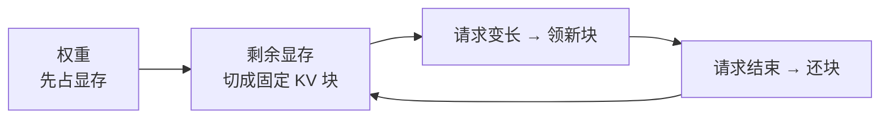

# KV 缓存与前缀缓存

> 生成下一个 token 时，模型要看前面每个 token 的键和值，这些键值就是 KV cache，留在显存里。Decode 每一步只追加最新一个 token 的键值，整段提示不用重算。

没有这块缓存，每生成一个字都要把从第一个 token 到当前位置全部重算，延迟随已生成长度明显变长；有了它，每步计算量大致稳定，显存占用则随上下文变长而上升。

## 显存先给权重，剩下的切成块

显存先放下权重——体积由参数量和量化位数决定，服务跑起来后基本不动。剩下的空间按显存占用比例切成固定长度的 KV 块。

- 单请求最多能领的块数由上下文上限决定；提示加已生成的 token 超过上限，请求被拒绝。
- 能同时挂住多少路对话，取决于每路实际领了多少块，而不是路数乘以上限。短对话还块之后，显存立刻给下一路。

## 前缀缓存留下公共开头

普通 KV 缓存只服务这一次请求，请求结束块就还回去。前缀缓存多留一步：下一次请求的开头若和已留住的块相同，这些块直接复用，这段 prefill 不用再算。

- **能命中的**：稳定的开头，例如系统提示、工具说明、反复出现的模板。
- **要重算的**：用户这一轮新说的话，以及据此新生成的回答——开头对不上。

命中省下的是 prefill 时间，decode 仍逐 token 生成，速度不因命中而变快。公共前缀越长、越稳定，省下的 prefill 越多。对话历史每轮都在变，命中率会停在「公共开头占总 token 的那一截」，不会接近百分之百。

## 引擎日志在说什么

vLLM 约每 10 秒打一行，里面有五样东西。这一行是窗口平均，要把空闲算进去。

| 字段 | 含义 | 注意 |
| --- | --- | --- |
| 提示吞吐 | 这 10 秒里 prefill 处理的 token 数 | 请求在窗口末尾才进来、或窗口大部分时间是空的，平均值会被拉低；不能换成「任意长度提示都按这个速度线性算完」 |
| 生成吞吐 | 这 10 秒里生成的 token 数 | 同样含空闲，窗口空闲时可能掉到每秒几个甚至 0；单次请求的逐 token 速度要单独计时，不用这行代替 |
| 正在跑/等的请求数 | 此刻在跑与排队的请求 | 配合 KV 占用判断显存是否被握住 |
| KV 占用 | GPU 上键值块占用比例 | 接近 0 表示采样时块已还回；占用升高且正在跑的请求数大于 0，表示此刻有请求握着块 |
| 前缀命中率 | 跨请求公共开头的复用比例 | 多半是累计口径，一天里移动很慢；它高只表示公共开头在被复用，不表示某路对话占满了显存 |

引擎启动时还会打印可用的块数量。那一行若没留在日志里，在线的占用百分比就只是相对值，看不出显存里一共切了多少块。
