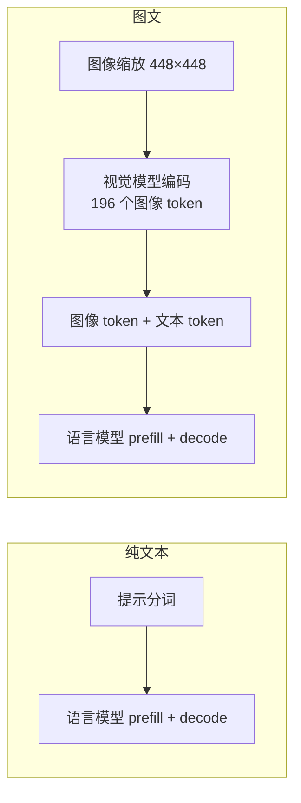

# Qwen3-VL 端侧性能

> Qwen3-VL-2B 在 RK3588 上的一次实测：纯文本三轮、图文三轮，记录首 token 时间、解码速度和峰值内存。测试时间 2026-10-10 15:21（UTC+8）。

## 测试路径

图文用的是一张 1024×640 的照片，运行时先补成方形，再缩放到 448×448；纯文本不加载视觉模型。

## 条件

| 项 | 值 |
| --- | --- |
| 平台 | RK3588，CPU 绑在大核 4、5、6、7 |
| 语言模型 | Qwen3-VL-2B 指令模型，W8A8，RKLLM |
| 视觉模型 | 输入 448×448，FP16，RKNN |
| 转换工具 | RKLLM-Toolkit 1.2.3 |
| 板端运行时 | RKLLM Runtime 1.3.1 |
| NPU 驱动 | 0.9.8 |
| NPU 核数 | 3 |
| 上下文上限 | 4096 |
| 单次生成上限 | 128 |
| 日志 | 打开运行时性能日志 |

首 token 取运行时表格里 Prefill 的总时间；解码速度取生成阶段的每秒 token。模型经常在 128 个 token 之前遇到结束符，所以各轮生成长度不同。句与句之间清空了 KV，测到的是冷前缀，没有命中上一句留下的键值。

## 总结果

| 模式 | 首 token（三轮均值） | 解码速度（三轮均值） | 峰值内存 |
| --- | ---: | ---: | ---: |
| 纯文本 | 141 ms | 10.55 tok/s | 2279 MB |
| 图文 | 1097 ms | 10.30 tok/s | 3157 MB |

> 核心结论：
> - **图像不改变解码速度**——解码阶段两边都是每 token 约 94–98 ms，回复变长只是这个速度乘上 token 数。
> - **图文慢在 prefill**：视觉模型编出 196 个图像 token，加问题文本后 prefill 约 210 个 token，时间稳定在 1.08–1.12 s，约是纯文本首 token 的 8 倍。
> - **图像编码本身 2196 ms**。本次演示在进对话前做一次，没算进每轮 prefill；若每次请求都重新编码，用户看到第一个字约 2196 + 1097 = 3293 ms。

## 纯文本

语言模型加载 8102 ms，运行时在第一轮另报初始化 6620 ms——发生在进对话之前，不计入首 token。峰值内存约 2279 MB。

三轮 prefill 均值 140.7 ms，解码均值 10.55 tok/s。短句的 prefill token 很少，用每秒 token 会把固定开销摊薄，比较时看总时间。

| 问题 | 首 token | Prefill tokens | Prefill tok/s | 解码耗时 | 生成 tokens | 解码 tok/s | 内存 |
| --- | ---: | ---: | ---: | ---: | ---: | ---: | ---: |
| 你好 | 174.0 ms | 9 | 51.7 | 767 ms | 8 | 10.43 | 2278 MB |
| 用一句话介绍 RK3588 | 117.8 ms | 16 | 135.8 | 3308 ms | 35 | 10.58 | 2279 MB |
| 请用两句话说明什么是 KV cache | 130.2 ms | 16 | 122.9 | 6014 ms | 64 | 10.64 | 2279 MB |

## 图文

同一张照片。视觉模型加载 4808 ms、图像编码 2196 ms，这两项在进程里只做一次，发生在对话循环之前；语言模型加载 4775 ms、第一轮初始化 3717 ms，同样不计入首 token。

三轮 prefill 均值 1097.2 ms，解码均值 10.30 tok/s。峰值内存约 3157 MB，比纯文本高约 878 MB。

| 问题 | 首 token | Prefill tokens | Prefill tok/s | 解码耗时 | 生成 tokens | 解码 tok/s | 内存 |
| --- | ---: | ---: | ---: | ---: | ---: | ---: | ---: |
| 用一句话描述这张图片 | 1083 ms | 211 | 194.8 | 2931 ms | 30 | 10.24 | 3157 MB |
| 图里有什么？ | 1116 ms | 210 | 188.1 | 12321 ms | 127 | 10.31 | 3157 MB |
| 这张图的主体是什么？ | 1092 ms | 212 | 194.1 | 7045 ms | 73 | 10.36 | 3157 MB |

127 个 token 那一轮碰到了生成上限，解码耗时约 12.3 s，速度仍是每秒 10.31 个 token。

## 怎么用这些数

- **首 token 是 prefill 的时间**。模型加载和初始化在进对话前完成，用户已在会话里时，不再把那几秒加进去；进程刚拉起的第一句，要把加载时间另算。
- **本表每轮都清空了 KV**。若上一句的键值还留着，新问题的 prefill 只覆盖新增文本，时间会靠近上面的纯文本短句，而不是再付一遍 1.1 s。
- **图像编码在进程里复用**，所以表里图文首 token 不含 2196 ms。业务侧若每次请求都重新编码，首字按「编码 2196 ms + 冷 prefill 约 1097 ms」估计。在线若只保留一轮历史、每轮清空或几乎无法命中前缀，就不能改用「命中历史之后的短 prefill」。
- **解码速度对生成长度不敏感**：本次在 8 和 127 个 token 上都约 10.3 tok/s；另一次把生成上限放到 1024、实际生成 11/276/459 个 token 的交互，解码为 10.25/9.94/9.39 tok/s，同一量级。生成变长几乎不改变每秒 token，只拉长总时间。
