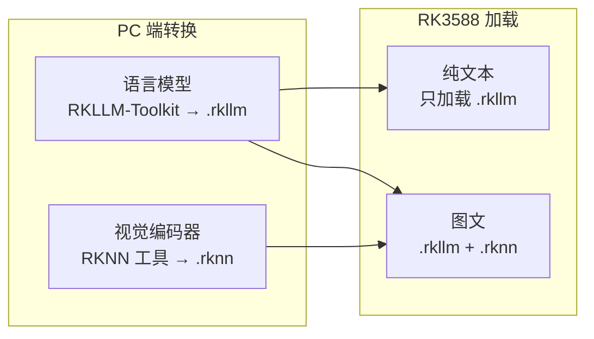

# RK3588 模型打包

> RK3588 的板上不直接加载训练时的浮点权重：先在 PC 上把模型收成板端文件，板子再用运行时加载。语言模型和视觉编码器是两份产物、两条工具链，不能打进同一个文件。

## 打包与加载流程

## 两份产物

| 产物 | 工具链 | 职责 | 要点 |
| --- | --- | --- | --- |
| `.rkllm` | RKLLM-Toolkit，PC 上转换并量化 | 语言模型本身 | 常见 W8A8（权重 8 比特、激活按 8 比特）；也有 W4 一路，体积更小，精度和速度另测。优化级别取 0，运行时的优化路径才会打开——级别设错，板上每秒 token 会对不上按该级别测出的速度 |
| `.rknn` | RKNN 运行时 | 视觉编码器：把图像变成语言模型能读的图像 token，不负责逐字生成 | 输入边长、精度写在这份编码器里；一张图变成多少图像 token 由分辨率和编码器决定，换边长或换模型，个数就变 |

NPU 内核驱动负责和三核 NPU 打交道。驱动没装好或与运行时版本对不上，两份模型文件都在，程序仍然起不来。**Toolkit、板端 Runtime、NPU 驱动要成套使用**——只升级其中一层，加载时会在版本上对不上。

## 纯文本和图文

- **纯文本**只加载 `.rkllm`，提示从分词进入语言模型。视觉模型不占内存，也不占用 NPU 做编码。
- **图文**要同时加载 `.rknn`：图像先经过视觉模型得到一串图像 token，再和文本 token 拼在一起，交给语言模型做 prefill 和生成。拼进提示的特殊标记必须和这份语言模型的配置一致——以 Qwen3-VL 为例，图像段用 `<|vision_start|>` 和 `<|vision_end|>` 包住，图像内容占位是 `<|image_pad|>`。标记和训练时的约定不一致，模型仍会生成，图像 token 却对不上位置。

有的模型还带音频编码器，同样是单独的一份 `.rknn`，用该模型自己的起止标记包住；不用这一路时，把音频文件和音频编码器的路径留空即可。

## 运行参数不在权重里

`.rkllm` 和 `.rknn` 里是权重和图。下面几项在每次启动时传入，改它们不用重新转换：

| 参数 | 说明 |
| --- | --- |
| 上下文上限 | 提示、图像 token 和已生成的 token 都算在里面 |
| 单次生成上限 | 新 token 到达这个数，或模型写出结束符，生成停止 |
| NPU 核数 | 设成 3 就是三核一起算 |

进程要能找到 RKLLM Runtime 的动态库，一般是把库目录放进库搜索路径后再启动；找不到库时，失败发生在加载之前，和权重对不对无关。

> 图文的顺序是固定的：视觉模型先编码，语言模型再 prefill、再生成。编码结果若留在进程里，下一句问同一张图就不必再编；每来一轮都重新编码，用户等到第一个字的时间要加上一整次编码。
