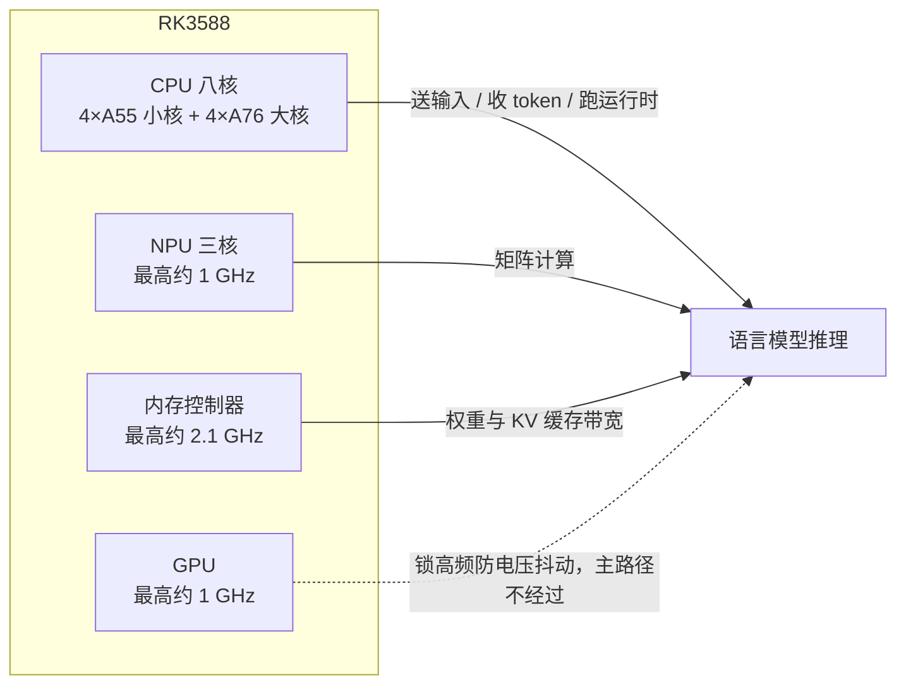

# RK3588 硬件

> RK3588 把 CPU、GPU、NPU 和内存控制器放在一颗芯片上，内存共享。跑语言模型时：矩阵计算走 NPU，权重和键值缓存走内存带宽，CPU 负责送输入、收 token、跑运行时，GPU 可同时高频但文本生成不经过它。

## 算力资源与推理负载的对应

## 各单元要点

| 单元 | 规格 | 与推理的关系 |
| --- | --- | --- |
| CPU | 4×A55 小核（policy0，最高约 1.8 GHz）+ 4×A76 大核（policy4/6，最高约 2.35 GHz） | 小核适合系统杂务、收发包、写日志；推理进程绑到大核，避免被调度到小核后首 token 跟着频率漂。测速通常指定后四颗核 |
| NPU | 三核，最高约 1 GHz，与 CPU 不同套时钟 | 视觉编码器和语言模型的 NPU 算子都用三核。核数设成 1/2，算力按核数下降，首 token 和每 token 都变慢 |
| GPU | 最高约 1 GHz | 文本生成不经过它；测速时锁高频，避免其他模块在测试中来回改电压 |
| 内存 | 控制器最高约 2.1 GHz；板子常见 4/8/16 GB | 每产出一个 token 都要把一大截权重从内存读进 NPU，内存频率掉下去，每秒 token 也掉 |

**测速前先锁频**：空闲时内核会降频，同一次计算前后会差一截。比较性能之前，关掉各核 idle、调速策略改成用户态、频率写成这一组最高档；同时钉住 NPU 时钟——只拉满 CPU、NPU 仍按负载升降时，每秒 token 会跟着负载抖动。

## 内存是硬边界

CPU、GPU、NPU 共用同一块内存，系统和别的进程还要分走一份。模型能不能装下，看三样东西加起来还剩多少：

| 占用项 | 由什么决定 |
| --- | --- |
| 量化后的权重 | 权重量化位数直接决定体积；W8A8 比浮点小，能腾出空间给 KV 缓存和第二路模型（如视觉编码器） |
| 键值缓存 | 上下文上限决定它随对话长到什么程度 |
| 运行时自身 | 固定开销 |

视觉模型和图文 token 只在图文路径里出现，纯文本不付这份内存。

内存不够时，加载失败或进程在运行中被系统杀掉——芯片不会自动改用更小的精度继续跑。换更大的模型，先看加载之后的剩余内存；算力规格只说明算得有多快，不说明放得下。

> 锁在最高频率上测到的速度，只保证这一次可重复。长期在线一直钉在最高档，功耗和温度上去后，热保护仍可能把频率拉低——在线服务要看温度稳住之后的速度。
