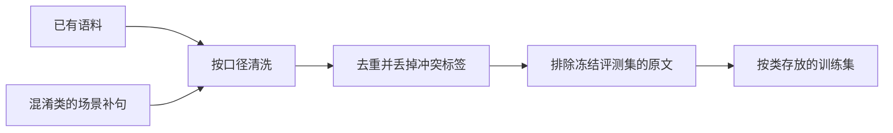
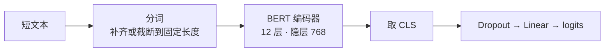

# BERT 微调

短文本要落到事先定好的几类表情。编码器加上一个分类头，用交叉熵把句子训到类别上，输出就锁在这几类里。生成式模型更重，也不容易把回答收成固定标签。

下面以中文短回复、八类表情为例：害怕、生气、疑惑、愉悦、无、悲伤、害羞、惊喜。换一套固定类别时，口径、划分和选点指标照同一套做。

## 先把口径写死

标注看的是说话人此刻该摆出的脸。句子里出现「伤心」「紧张」，并不自动落入对应的类。

| 类 | 标 | 不标 |
| --- | --- | --- |
| 害怕 | 惊吓、恐惧、危险，上台或见人之前的发怵 | 运维式「先暂停操作」；单纯害羞时的紧张 |
| 生气 | 指责、发火、被冒犯、威胁式警告 | 翻白眼、阴阳怪气、懒得理 |
| 疑惑 | 没听懂、前后矛盾、真在发问 | 语气平静的事务询问 |
| 愉悦 | 开心、寒暄示好、满足、邀约时的高兴 | 惊喜的「没想到」；被夸之后的羞 |
| 无 | 通知和指引、安抚对方、出糗尴尬、嘲讽白眼 | 明显的喜怒哀惧 |
| 悲伤 | 失落、想念、抑郁、心疼自己 | 惊吓；生闷气 |
| 害羞 | 被注视、被夸、表白、初见时的羞赧 | 纯开心；纯害怕 |
| 惊喜 | 意外、没想到、哇居然 | 计划内的高兴；惊吓 |

「无」内部还可以再看四种情况，用来分析错例：通知（会议室在三楼）、安抚（别想太多）、尴尬（发错群）、嘲讽（行了吧、画大饼）。这四种子型留在分析里。模型的输出维仍然是上面八类：没有尴尬脸和翻白眼可摆，安抚对方时脸保持平静。生气和嘲讽的分界是发火、威胁归生气，不耐烦、阴阳怪气归无。

几组容易混的句子写进口径，标注和补数据都按这个分：

- 「好紧张」：上台、危险归害怕；被喜欢的人注视归害羞。
- 「你怎么能这样，我真的很伤心」归悲伤。
- 「这个功能怎么用」：平静请教归无；明显转不过弯、对不上归疑惑。
- 「居然 / 没想到 / 哇」：意外本身归惊喜；计划内的高兴归愉悦；惊吓归害怕；没听懂归疑惑。
- 离开、空、不在、群变安静归悲伤。夜里、门口这些场景词单独出现，仍按这句话在说什么标。

类别顺序在三处保持一致：配置里的类别列表、标签表里的 id、数据文件里的标签字段。训练开始时核对配置和标签表，不一致就停。数据里用稳定的英文 id（`afraid`、`angry` 等），展示时再用中文名。增删类别时，配置、标签表、数据、冻结的评测集一起改。

## 数据怎么来

从已有语料出发，先按口径拿掉标错的句子。典型的一批是操作指令被标成害怕：「先暂停操作」「先确认风险」说的是步骤。拿掉之后，只给仍然混淆的类补真实场景句，例如害怕、害羞、无。已经分开的类不必为了凑条数再平均加水。

一条样本一行：文本加类别 id。读入时丢掉空文本、未知标签、短于两个字的句子。同一句话出现两次且标签相同，留一条；两条标签互相冲突，都丢掉，避免监督自相矛盾。

评测用的手工句子事先冻结。合成训练集时排除这些原文，也排除用来探盲区的扩充句，避免同一句话既出现在训练里又出现在考试里。

划分用分层抽样，大约 8:1:1，种子固定，两次实验才能对齐。这份测试集和训练来自同一堆句子，只能看出模型有没有记住这堆分布。换数据、换参数、换骨干时，对比同一份冻结的手工集。手工集要改，单独立项，否则前后分数没法比。划分测试到了九成、手工集停在七成上下，说明训练句彼此太像，上线观感以手工集为准。

## 模型

参数大约一亿，几乎都在编码器里。取编码器的 pooler 输出；没有 pooler 就用最后一层第一个位置。分类头是一层线性变换，权重用标准差 0.02 的正态初始化，偏置为 0。前向直接返回 logits。交叉熵打在 logits 上；softmax、取最大类、低置信时改成兜底类，都留在推理。

数据很少时可以冻住编码器，只训分类头，先确认这批句子和标签能分开。句子够了就全参微调。全参微调的学习率用 `2e-5` 这一档，比从头训练小很多，避免把预训练的中文表示冲掉。若接着一次冻住编码器的权重继续训，要把编码器解开。

隐层宽度从预训练配置读取。换骨干就要重新训练，分词和下游使用的固定长度一起换。

分数上不去时，先核对口径和训练句是不是同一套分布。层数、多头、把上一句历史拼进来，解决不了标签和场景没对齐的问题。

## 参数各自决定什么

超参、路径、阈值写在同一份配置里。对比实验只改这一份，种子保持不变。

| 参数 | 这一档任务上的取值 | 决定什么 |
| --- | --- | --- |
| 学习率 | `2e-5` | AdamW 的峰值。全参微调 BERT 常用这个量级；再大，预训练特征容易被冲掉 |
| batch | 16 | 显存不够再降。batch 一变，每个 epoch 的 step 数就变，warmup 的步数跟着变 |
| epoch 上限 | 25 | 循环最多跑这么多轮。真正停靠早停，很少跑满 |
| warmup 比例 | 0.1 | 总 step 的一成用来把学习率从 0 升到峰值，之后线性降到 0。每个 batch 更新一次 |
| 权重衰减 | 0.01 | 抑制权重过大 |
| 梯度裁剪 | 1.0 | 单步更新的幅度上限 |
| 早停耐心 | 3 | 验证 Macro F1 连续 3 个 epoch 没有超过历史最佳就停，并加载最佳权重 |
| 标签平滑 | 0.1 | 正确类大约留 0.9，其余类分掉 0.1。减轻「分错了仍然给出接近 1 的概率」 |
| 类别权重 | 关 | 打开后按训练集频数的反比加权。少类极少时有用；少类一旦被灌得很多，权重会压过其它类 |
| 序列长度 | 128 | 短句补齐，超长截断。单条回复通常远短于 128。下游要固定形状时，训完再改长度就要重新导出 |

选模型的指标是验证集 Macro F1。类别一旦不均衡，准确率会被大类撑住，checkpoint 里可以记下准确率，比较时以 F1 为准。

推理可以设置信度阈值：最大概率低于阈值就改成兜底类「无」。阈值放在 0.35 时，不少错例的概率仍然高于 0.9，阈值碰不到它们。先把标签平滑和数据做好，再考虑把阈值抬高。

## 一个 step 在做什么

训练模式下累计的准确率到后期会接近满分，它说明这批句子被拟合了。验证时关掉 Dropout、停掉梯度，留下全部预测，用来算 Macro F1 和混淆矩阵。验证 F1 超过历史最佳才覆盖最佳权重；每一轮的权重可以另存，方便回看是从哪一轮开始变差的。跑完后用最佳权重量一遍划分出来的测试集，看分类报告。这个数和冻结手工集分开读。

一轮迭代是：改口径或补句子，重新合成训练集并继续排除金标原文，再训练，最后在同一份冻结集上对比。
