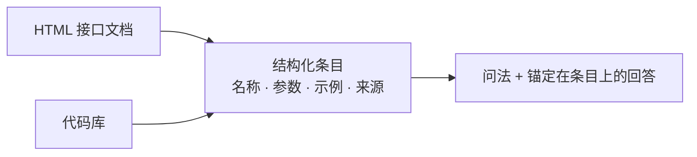
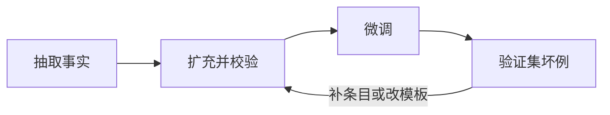

# LoRA 微调

小模型已经会对话，缺的是一批领域事实：某个接口怎么调用、参数有哪些、旁边的示例长什么样。LoRA 在指定线性层旁边加一块低秩增量，训练时只更新这块增量，基座冻住。领域事实因此写进适配器，基座的通用能力留在原处。

下面按「文档和代码 → 指令数据 → 训练 → 推理服务」说明。秩、学习率和基座规格随模型和数据量重选，这里不给一套通用数字。

## 先抽出可引用的事实

指令由问法和回答组成。回答要能对回一条已经抽出的事实。事实来自两类原料，抽完之后对齐到同一份字段：名称、签名或路径、参数、一段可引用的示例、来源位置。这一步还没有问答。

| 原料 | 怎么抽 | 留下什么 |
| --- | --- | --- |
| HTML 接口文档 | 用 BeautifulSoup 这类解析器按标签取标题、参数表和代码块 | 一个接口一条记录。导航、页脚、重复侧栏丢掉 |
| 代码库 | 用 tree-sitter 这类语法树按函数或方法节点切开 | 签名、紧挨着的说明、相邻的调用示例 |

整页或整文件先不要塞进样本。抽出来的条目才是以后写答案时要对回去的依据。

## 把事实扩成指令

文档里的参数说明和代码里的调用示例拼成一条回答。问法用两种办法变多：

- 同义改写：同一个接口换几种问法，例如怎么调用、参数是什么、给一个例子。
- 模板填充：问法模板里换上真实的函数名、参数名和示例。模板只允许填已经抽出的条目。

这样可以把规模扩到原来的大约三倍。变多的是问法，每条回答仍然对得回源条目。模板若允许自由填写文档里没有的接口名，模型会把编造的调用一起学进去。

评测问法从原文档和原代码里留出。这些问法不参与改写，也不进入训练集。

## 质量闭环

进训练前先做清洗和格式校验。

| 检查 | 处理 |
| --- | --- |
| 空字段 | 没有签名、没有示例，或问法、回答为空，丢掉 |
| 残缺抽取 | 签名被截断、参数表只剩半行、代码块没闭合，退回重抽 |
| 标记残留 | 页面标签、导航文字混进正文，丢掉或清掉再入库 |
| 过长 | 整页或整文件塞进一条样本、超出这次训练的长度上限，拆回条目或丢掉 |
| 对不回来源 | 回答里的函数名、参数在源条目中找不到，丢掉 |
| 泄漏 | 评测问法，或和评测只差几个字的改写，出现在训练里，从训练中拿掉 |

样本格式收成推理时会用的对话：系统说明、用户问法、助手回答字段齐全。缺一段时训练仍能跑，上线时模板会对不上。

微调之后用验证集看坏例。验证集用没有参与改写的原问法。改写句留在训练里，用来覆盖换一种问法仍然要答对的情况。

坏例分三类，回到抽取或模板：

| 坏例 | 回到哪里 |
| --- | --- |
| 幻觉接口、编造参数 | 回答没有锚在源条目上。收紧模板，或把该接口的抽取补全 |
| 漏了必填参数 | 抽取时参数表丢了，或回答模板没有要求写全 |
| 答非所问 | 问法和条目配错，或多源合并时接上了另一个函数的示例 |

学习率留到事实和格式已经对得上之后再动。损失在降、坏例的种类不变，说明还在拟合问法，条目或模板还没补上。

## 训练时对齐的几件事

PEFT 把 LoRA 适配器挂到基座的注意力和前馈线性层上，优化器只看到这部分参数。秩决定增量的容量：秩小，可训练参数和显存更少，领域条目多时可能记不住；秩大，容量更接近全参更新，也更吃显存。目标模块要和基座的层名对上，挂错层等于几乎没有训到增量。

DeepSpeed 把优化器状态拆到多张卡或卸到内存，用来放下训练时的优化器开销。数据加载和它对齐三件事：

- 微批次是每张卡每次前向的样本数。梯度累积把若干个微批次合成一次参数更新。全局批次等于卡数 × 微批次 × 累积步数。这三项对不齐时，学习率日程和实际看到的数据量会错开。
- 损失只打在回答段。问法部分掩掉，模型不必把用户的问题再复读一遍。
- 对话模板、特殊符号和最大长度，与最终推理服务使用同一套。训练时多一个角色标记、推理时少一个，损失可以下降，上线格式仍然是错的。

学习率、秩、训练步数写进配置。换基座就重选，不沿用上一个模型的数字。

## 交给推理服务

训完保留适配器权重，以及它对应的基座版本。SGLang 一类服务按这个基座加载适配器。也可以把适配器合并进基座再导出。两种交付选一种：服务若同时看到未合并的基座和已经合并过的权重，等于加载了两套增量。

上线前用训练时留下的那套坏例再跑一遍，核对函数名、参数、示例是否还在，对话模板是否和训练一致。格式对齐之后，再看新的问法。
