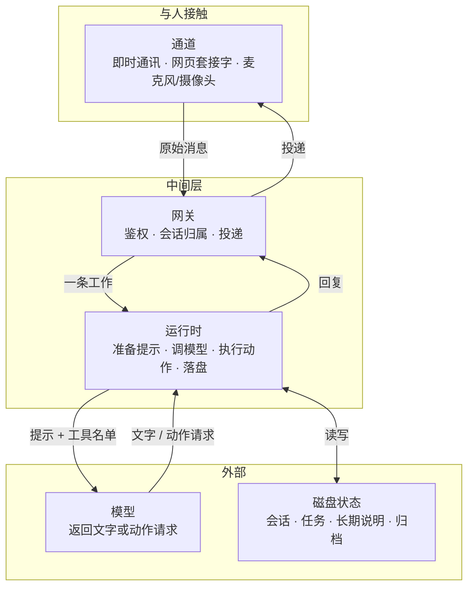

# 智能体架构

智能体是一台机器上的常驻运行时，大语言模型是它在需要判断时叫来的大脑。模型在给定的提示和工具范围内做下一步决定；通道、日程、权限、磁盘状态由运行时握住。把两者当成同一件事，会把「会说话」误写成「能把一件事做完」。

## 分层

系统从上到下分五层。依赖方向固定：上面可以调用下面，下面不反向认识上面的实现。

| 层 | 职责 |
| --- | --- |
| 通道 | 与人接触：收进原始消息，送出要给人看的文字或动作 |
| 网关 | 把通道事件变成一条工作：确认触发者有权、决定会话归属、按通道长度和格式投递 |
| 运行时 | 握住一轮工作生命周期：准备提示、调模型、执行动作、决定何时结束、把状态落盘 |
| 模型 | 云端大脑：看到提示和允许的能力，返回文字或「请执行某个动作」，不认识通道、不持日程 |
| 磁盘状态 | 进程重启后仍在：会话标识、待执行任务、长期说明、归档；进程内存只覆盖正在进行的这一轮 |

通道不认识模型的接口，模型不认识某个通道的用户编号和消息格式。网关把两边都收成同一种东西：进来是一段提示，出去是一段要投递的文字或一组已执行完的动作。

## 一轮工作从哪来

运行时不关心原始包长什么样。网关先把来源收成一段提示，再交给一轮工作。来源有三种：

| 来源 | 触发方式 |
| --- | --- |
| 用户消息 | 文本、语音转写后的文本 |
| 到点任务 | 调度器发现任务到期，用任务里保存的提示发起一轮 |
| 感知事件 | 现场变化（有人出现、画面变化、状态越过阈值）先变成「发生了什么」的提示，再进运行时 |

三种来源共用同一次调用模型的路径，差别在网关选定的会话策略，以及这一轮结束后要不要主动把结果发给用户。

网关同时守住入口：个人助手只接受主人的消息；接待场景按设备编号维持连接，连接上登记设备当前场景，场景决定本轮用哪一套身份说明、哪一张执行图。

## 两种循环

一轮工作内部有两种组织方式，解决不同的控制问题，可出现在不同产品里，也可由同一运行时按场景选用。

| 维度 | 工具循环 | 规划图 |
| --- | --- | --- |
| 组织方式 | 提示+工具交给模型，循环调用直到停 | 固定阶段：开始 → 规划 → 执行 → 结束 |
| 适合场合 | 下一步要等上一步的结果才知道 | 一轮的产出本来就有好几路 |
| 停机方式 | 写死的条件，不靠模型「觉得可以了」 | 阶段自然结束 |

### 工具循环

模型要调用工具时，宿主在本进程执行、把短结果送回模型再问下一次；模型不再要工具、只给出文字时，一轮结束。停机条件写死：

- 模型返回最终文字，且没有未完成的工具调用；
- 达到步数或时间上限：释放这一轮占用的执行权，把失败告诉用户；
- 宿主判定工具返回错误，交回模型后模型仍无法继续。

工具的执行权在宿主。模型只能在运行时预先允许的名单里点名（发消息、登记任务、读写工作区文件都是名单上的名字），看不到通道的连接对象，只能调用「把这段文字发给当前用户」这样的工具，真正的投递由网关完成。日常对话沿用上次的会话标识；用户明确要求清空时删掉标识，下一句从头开始。

### 规划图

规划图把一轮拆成固定的几个阶段，不让同一个模型一直调用工具直到自己停：

1. **开始**：按当前用户和设备装入近期对话、少量检索到的事实、设备状态，此时不生成回复。
2. **规划**：规划节点只输出一份计划——要运行哪些专用节点、并行还是串行。它不读网页原文、不看整段画面、不执行动作。
3. **执行**：运行时按计划组一张子图。并行节点同时跑，彼此不转发中间文本；串行节点按箭头顺序跑，后一个只看见前一个交回的结论。
4. **结束**：清洗本轮回复、写入对话记录，把需要下发的话语、动作、表情一次发给通道。

合法的节点集合由场景事先注册，规划节点只能从名单里挑选和组合，不能临时发明节点。不同场景注册不同的图：通用交谈一组，点单或迎宾另一组。换场景是换注册表，不是换进程。

## 收包和对话分开

通道上的包不全是「请回答的一句话」。心跳、播报是否正在进行、休眠和唤醒都是控制消息，必须在收到的瞬间处理。如果收包和生成共用一条循环，一轮较长的生成会堵住收包：心跳得不到应答，连接被判定断开；播报结束的状态进不来，下一句又在等播报结束，两边互相等待。

连接上有两条循环：

- **收包循环**只做解析和路由：控制消息立即回复；用户的一句话放进有长度上限的队列。
- **对话循环**从队列里取工作，串行跑完一轮再取下一轮。

队列满了就拒绝新的用户句，而不是无限堆积。控制消息不进这个队列。

## 同一时刻只跑一轮生成

生成会占住模型调用和本机的执行权，两轮同时跑还可能交错写同一份会话状态。运行时用一把锁保证同一时刻只有一轮生成：

- 用户对话进行时，到点的心跳跳过这一拍，下一拍再看；
- 到期的任务可以排队，但每一轮都有超时，避免一条卡住的任务把后面的对话堵死；
- 多个任务到期时串行执行。

会话策略也在这里定死：日常对话沿用上次的会话，使用户接着上一句说话；定时任务和心跳各开一轮短会话，不把提示写进日常聊天记录。

## 环外的四块状态

下面四块都不在「调用一次模型」的内部。运行时在一轮开始前读取它们，在一轮结束后写回需要留下的部分。

| 状态 | 位置与规则 |
| --- | --- |
| 身份说明 | 每轮开始组装进系统提示词：这一轮是谁、在帮谁、有哪些底线 |
| 记忆库 | 在模型外面，按当前问题取出少量内容放进提示，不把库存全文交给模型 |
| 技能正文 | 留在工作区的文件里，提示词里先只有名称和适用时机 |
| 调度器 | 自己不调用模型，只负责到点把一条任务变成一次唤醒 |

这四块各自有完整的读写规则。架构层只保证一件事：它们都在循环外面，由运行时在轮与轮之间保管。
