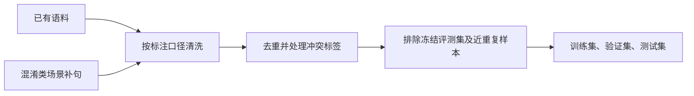

# BERT 微调：短文本表情分类

BERT 适合将短文本映射到预先定义的固定类别。对于表情分类，可以在预训练编码器上增加一个分类头，通过交叉熵损失训练模型，使其根据句子语义预测对应类别。

与生成式模型相比，BERT 分类模型结构更简单，输出类别固定，推理时不需要生成自然语言回答，适合类别明确、响应速度要求较高的分类任务。

下面以中文短回复的八类表情分类为例：**害怕、生气、疑惑、愉悦、无、悲伤、害羞、惊喜**。更换类别时，应同步调整标注口径、标签映射、数据集和评测指标。

## 一、先统一标注口径

标注目标是判断说话人此刻适合呈现的表情，而不是根据句子中出现的情绪词直接分类。同一个词在不同语境下可能对应不同类别。

| 类别 | 标注范围 | 不应归入的情况 |
| --- | --- | --- |
| 害怕 | 惊吓、恐惧、危险，以及上台或见人前的发怵 | 运维式「先暂停操作」；单纯害羞时的紧张 |
| 生气 | 指责、发火、被冒犯、带有愤怒的威胁或警告 | 单纯翻白眼、阴阳怪气、不耐烦 |
| 疑惑 | 没听懂、逻辑矛盾、明显困惑或无法理解 | 语气平静的事务询问 |
| 愉悦 | 开心、友好寒暄、满足，以及邀约时的高兴 | 意外带来的惊喜；被夸后的羞赧 |
| 无 | 通知、指引、安抚、出糗后的尴尬、嘲讽或不耐烦 | 明显的喜怒哀惧 |
| 悲伤 | 失落、想念、难过、心疼自己或他人 | 惊吓；主要表现为愤怒的生闷气 |
| 害羞 | 被注视、被夸、表白或初见时的羞赧 | 纯粹开心；纯粹害怕 |
| 惊喜 | 意料之外的好消息、惊讶和意外发现 | 计划内的高兴；由危险引起的惊吓 |

「无」并不代表文本没有情绪，而是指在当前八分类口径下，不需要表达其他七类表情。

「无」内部可以继续记录四种子型，用于错误分析：

- **通知：** 会议室在三楼。
- **安抚：** 别想太多。
- **尴尬：** 发错群了。
- **嘲讽：** 行了吧、又画大饼。

这些子型仅用于分析，模型最终仍输出八类之一。生气与嘲讽的边界是：明确发火、指责或威胁归生气；主要表现为阴阳怪气、不耐烦或讥讽，且没有明显愤怒时归无。

### 容易混淆的句子

- 「好紧张」：上台或面对危险时归害怕；被喜欢的人注视时归害羞。
- 「你怎么能这样，我真的很伤心」：归悲伤。
- 「这个功能怎么用」：平静请教归无；明显困惑、无法理解时归疑惑。
- 「居然」「没想到」「哇」：意外本身归惊喜；计划内的高兴归愉悦；受到惊吓归害怕；没听懂归疑惑。
- 「他不在了」「群里突然安静了」：只有在语境明确表达失落或想念时才归悲伤，不能仅凭「不在」「安静」等词判断。
- 「夜里」「门口」等场景词不直接决定类别，应根据整句话的含义标注。

### 固定标签映射

类别顺序必须在配置文件、标签表和数据集中保持一致。建议使用稳定的英文 ID 存储标签，展示时再映射为中文名称。

```python
labels = [
    "afraid",
    "angry",
    "confused",
    "happy",
    "neutral",
    "sad",
    "shy",
    "surprised",
]
```

训练开始前，应校验标签表、数据标签和模型输出维度是否一致；不一致时停止训练。增删类别时，应同步更新标签映射、数据集、分类头和冻结评测集。

## 二、数据构建与清洗



从已有语料出发，先按照统一口径清理错误标签。例如，「先暂停操作」「先确认风险」表达的是操作步骤，不应仅因包含「风险」就标为害怕。

清洗后，只针对仍然容易混淆的类别补充真实场景句，例如害怕、害羞和无。不需要为了让每个类别数量相等而机械扩充；应根据类别分布、混淆矩阵和实际使用场景补充数据。

### 数据格式与去重

每条样本包含文本和类别 ID，例如：

```json
{"text": "这个功能怎么用？", "label": "neutral"}
{"text": "居然真的成功了！", "label": "surprised"}
```

读入时应：

- 删除空文本、未知标签和不符合任务要求的异常样本。
- 根据任务定义设置最短文本长度；短于两个字的文本应先检查是否有实际分类价值，而不是一律认定无效。
- 同一句话出现多次且标签一致时，保留一条或按明确的采样策略处理。
- 同一句话存在冲突标签时，优先人工复核；无法确认的样本应排除，避免监督信号相互矛盾。

### 训练集与评测集划分

应事先冻结手工评测集，并在合成训练数据时排除其中的原文及近重复改写，防止相同句子同时出现在训练集和评测集中。

对于已有语料，可以使用分层抽样，以约 8:1:1 的比例划分训练集、验证集和测试集，并固定随机种子。该比例只是起点，应根据数据量和类别分布调整。

三份数据的用途不同：

- **训练集：** 更新模型参数。
- **验证集：** 选择模型、调整超参数和阈值。
- **测试集：** 在模型配置确定后进行最终评估。
- **冻结手工评测集：** 检查真实场景和易混淆边界上的表现，用于不同实验之间的稳定对比。

冻结手工集应与训练数据隔离，且不应反复用于调参。如果根据手工集的错误不断补句或改规则，应另建开发集，保留原手工集用于独立评估。

随机测试集表现很好、手工集表现明显较差，通常说明数据分布或场景覆盖存在差异，也可能存在近重复样本或训练集过于简单的问题。此时不能只依据随机测试集判断上线效果。

## 三、模型结构


以常见的中文 BERT-base 为例，模型通常包含 12 层 Transformer 编码器，隐藏维度为 768，参数规模约为 1 亿。具体结构应从所用预训练模型的配置读取，不应假定所有 BERT 模型规格一致。

输入文本经过 tokenizer 转换为 token ID，并按照配置进行补齐或截断。编码器输出隐藏状态后，可以采用以下两种常见表示：

- **Pooler 输出：** 使用模型提供的池化结果；具体定义取决于预训练模型的实现和训练方式。
- **`[CLS]` 隐状态：** 直接取最后一层第一个 token 的隐藏向量。

两者并不相同，应根据基座模型结构和验证结果选择，并在训练与推理中保持一致。

分类头通常为 Dropout 加线性层，输出八个 logits：

$$
\mathbf{z} = W\mathbf{h} + \mathbf{b}
$$

其中，$\mathbf{h}$ 为句子表示，$W$ 和 $\mathbf{b}$ 为分类头的权重和偏置，$\mathbf{z}$ 为八类未归一化分数。

分类头可以采用标准差为 0.02 的正态分布初始化权重，并将偏置初始化为 0。具体初始化策略应与训练框架配置一致。

训练时直接将 logits 输入交叉熵损失，不需要提前执行 softmax：

$$
\mathcal{L} = -\log p_y
$$

其中，$p_y$ 表示模型对真实类别的预测概率；标准交叉熵内部会完成相应的归一化计算。

推理时才根据需要执行 softmax、选择最大概率类别，并应用经过验证集校准的置信度阈值。

### 冻结训练与全参数微调

数据较少时，可以先冻结 BERT 编码器，只训练分类头，用于验证数据和标签是否具备一定的可分性。但冻结训练效果不佳，不一定代表标签错误，也可能是预训练表示不足以区分当前类别。

当数据量和标注质量足够时，可以解冻编码器进行全参数微调。BERT-base 分类任务的学习率可从 `2e-5` 附近尝试，具体仍需通过验证集确定。

如果先冻结编码器训练分类头，再继续训练，则需要显式解冻编码器，并重新检查优化器是否包含解冻后的参数。

隐藏维度、层数和 tokenizer 都应从基座配置读取。更换骨干模型后，需要重新训练分类头，并验证分词、最大序列长度和推理输入格式。

当模型效果不佳时，应先检查标注口径、训练数据分布和类别混淆，再考虑更换骨干、加入上下文或调整网络结构。

## 四、训练参数与模型选择

超参数、数据路径、标签映射、阈值和随机种子应集中管理。对比实验尽量只调整少数参数，并保持其他条件一致。

以下参数适合作为一组初始实验配置，不代表所有数据集上的最优设置。

| 参数 | 初始设置 | 作用与注意事项 |
| --- | --- | --- |
| 学习率 | `2e-5` | 全参数微调的常见起点；过大可能破坏预训练表示 |
| `batch_size` | 16 | 每批样本数；受显存、序列长度和模型大小限制 |
| `num_train_epochs` | 上限 10 | 最大训练轮数，实际通常由早停决定 |
| `warmup_ratio` | 0.1 | 前 10% 的训练步数用于学习率预热 |
| 学习率调度器 | `linear` | 预热后按计划将学习率线性衰减至零 |
| `weight_decay` | 0.01 | 权重衰减，通常使用 AdamW |
| `max_grad_norm` | 1.0 | 梯度裁剪阈值，限制梯度范数 |
| 早停耐心 | 3 | 验证集 Macro F1 连续 3 个评测轮次未改善时停止 |
| 标签平滑 | 0.1 或关闭 | 软化训练目标，是否启用应通过验证集判断 |
| 类别权重 | 默认关闭 | 类别明显不均衡时，可尝试按训练集频数设置权重 |
| `max_length` | 128 | 最大输入长度；根据文本分布统计和截断率确定 |

### 参数调整注意事项

**学习率与训练步数：** 每个 epoch 的更新步数取决于训练集大小、批次大小、梯度累积和分布式配置。修改 batch size 后，warmup 的实际步数和训练总步数也可能变化。

**标签平滑：** 启用 `label_smoothing=0.1` 时，真实类别的目标概率会被降低，其余类别分配少量概率质量。它可能改善泛化，但也可能降低部分任务的分类效果，不能保证模型不会对错误预测给出高置信度。

**类别权重：** 可以依据训练集类别频数调整各类损失权重，但应防止少数类权重过高而影响整体表现。是否使用，应根据类别分布和各类召回率判断。

**序列长度：** `max_length=128` 对多数短回复可能足够，但应统计实际 token 长度及截断比例。训练与推理应采用一致的 tokenizer 和截断规则；若只是改变 padding 长度且模型支持动态长度，通常不需要因此重新训练，但改变分词器或输入处理方式可能影响结果。

### 模型选择指标

建议以验证集 **Macro F1** 选择最佳 checkpoint，同时记录准确率、各类别 Precision、Recall、F1 和混淆矩阵。

Macro F1 是各类别 F1 的算术平均：

$$
F1_{\text{macro}} =
\frac{1}{C}\sum_{i=1}^{C}F1_i
$$

其中 $C=8$。当类别不均衡时，准确率可能被多数类主导，而 Macro F1 能更直观地反映各类别的整体表现。

早停应依据验证集指标执行，并在训练结束后加载最佳 checkpoint，再对测试集和冻结手工评测集分别评估。不要用训练集上的高准确率代替泛化能力判断。

### 推理置信度阈值

推理时可根据 softmax 最大概率设置阈值：

$$
\hat{p} = \max_i \operatorname{softmax}(\mathbf{z})_i
$$

若 $\hat{p}$ 低于阈值，可以将结果标记为低置信度，交由人工复核或采用业务定义的兜底策略。

不建议直接认定低置信度样本都属于「无」，因为「无」是一个真实的表情类别，不等于模型不确定。若业务必须输出八类之一，可以在校准后采用兜底策略，但应单独评估其误判率。

阈值应通过独立验证数据选择。softmax 概率高不代表预测一定正确，因此不能仅凭一个固定阈值判断模型是否可靠。

## 五、一个训练 step 在做什么


一个训练 step 通常包括前向计算、损失计算、反向传播、梯度裁剪和优化器更新。使用梯度累积时，多个微批次的梯度会累积后再执行一次参数更新。

训练模式下启用 Dropout 并计算梯度；验证模式下应切换到 `eval()`，关闭 Dropout，并使用 `no_grad()` 或 `inference_mode()` 停止梯度计算。

训练集准确率逐渐接近满分，说明模型越来越能拟合训练样本，但不能证明它已经学会真实场景中的表情边界。

每轮训练后，应在验证集上计算 Macro F1 和混淆矩阵。只有当验证指标超过历史最佳时，才更新最佳 checkpoint；必要时另存每轮权重，分析模型从哪一轮开始过拟合。

训练完成后，加载最佳 checkpoint，在固定测试集上生成分类报告，并单独评估冻结手工集。两类结果应分开记录，因为它们衡量的场景不同。

## 六、迭代闭环

一轮迭代包含以下步骤：

1. 分析验证集和手工评测集中的错误，确认问题来自标注、数据覆盖还是模型。
2. 修订标注规则，或针对混淆类别补充真实场景句。
3. 重新清洗、去重和划分数据，确保冻结评测集原文及近重复样本不进入训练集。
4. 在相同配置和固定随机种子下训练，并根据验证集 Macro F1 选择模型。
5. 在同一份冻结评测集上比较不同实验，记录各类别指标、混淆矩阵和错误案例。

每次修改应尽量聚焦一个主要因素，例如先修复害怕与害羞的边界，再调整学习率或标签平滑。这样才能判断效果变化究竟来自数据、标注口径还是训练配置。