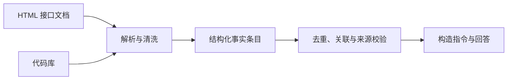

# LoRA 微调：从领域知识构建到训练部署

一个已经具备基本对话能力的小模型，在回答特定领域的接口文档、参数说明和代码示例时，仍可能出现知识缺失或回答不准确的问题。

LoRA（Low-Rank Adaptation，低秩适配）通过在基座模型的指定线性层中引入可训练的低秩增量，在冻结基座权重的情况下调整模型行为，减少可训练参数量和训练成本。

需要注意，LoRA 并不是将领域事实像数据库一样逐条写入适配器，而是通过训练数据调整模型参数，使模型更好地学习领域知识及其表达模式。对于要求严格准确、持续更新的接口信息，还应结合检索或工具调用。

下面按照「文档与代码解析 → 指令数据构造 → 质量验证 → LoRA 训练 → 推理部署」展开。秩、学习率、目标模块和训练步数应结合基座模型、数据规模及验证结果确定。

## 一、抽取可追溯的领域事实

指令数据由用户问法和助手回答组成。在构造问答之前，应先从原始文档和代码中提取结构化事实，形成统一的领域知识条目。

每条记录尽量包含以下字段：

- **标识信息：** 接口名、函数名、类名或方法名。
- **定义信息：** 函数签名、接口路径、HTTP 方法或所属模块。
- **参数信息：** 参数名、类型、是否必填、默认值及含义。
- **返回信息：** 返回类型、字段结构、异常或错误码。
- **示例信息：** 与接口对应的调用示例。
- **来源信息：** 文件路径、文档 URL、代码位置或版本号。

不同来源未必包含全部字段。缺失信息应标记为未知或不适用，不能根据上下文自行补全。

| 原始来源 | 抽取方式 | 主要产物 |
| --- | --- | --- |
| HTML 接口文档 | 使用 BeautifulSoup 等解析器，根据 DOM 结构、标题、参数表和代码块定位内容 | 接口定义、参数说明、返回结构和示例 |
| 代码库 | 使用 tree-sitter 等语法解析工具，按函数、方法、类等语法节点切分 | 签名、注释、类型信息和调用示例 |

HTML 文档应优先利用页面结构定位内容，而不是直接切分整页文本。代码库则应尽量利用语法边界，避免截断函数或混入相邻函数的内容。

抽取后还应进行去重、来源关联和版本校验。例如，只有在函数名、模块、签名及版本等信息能够对应时，才应合并文档与代码中的记录；无法确认的内容应保留差异。

整页文档或整份源文件不宜直接作为一条训练样本。应先形成原子化、可追溯的事实条目，再基于这些条目构造问答。



## 二、基于事实条目构造指令数据

事实条目确定后，再将其转换为模型训练所需的指令样本。

例如，一条接口记录包含函数名、参数定义和调用示例，就可以据此生成以下问题：

- 这个函数的作用是什么？
- 这个函数有哪些参数？哪些参数是必填的？
- 如何调用这个函数？
- 给出一个符合实际签名的调用示例。

回答必须以对应的事实条目为依据。对于文档没有说明的内容，应明确说明未知，而不是为了让答案完整而自行推断。

### 1. 扩充问法

可以采用两种方式增加训练样本的表达多样性。

**同义改写：** 针对同一条事实生成不同表达的问法，例如「如何调用该接口」「该函数的参数有哪些」「请给出调用示例」。

**模板生成：** 使用预先定义的问题模板，并填入已抽取的函数名、参数名和接口路径等真实字段。

模板中的变量只能引用经过校验的事实条目。对于来源中不存在的接口、参数和返回值，不应自由生成训练答案。

数据扩充的目标是提高问法覆盖度，而不是单纯增加样本数量。扩充到原始数据的三倍可以作为实验起点，但不是通用规律。重复或高度相似的问法过多，反而可能降低有效数据的多样性。

### 2. 划分训练集与评测集

应在生成大量改写问法之前，先按原始事实条目或相关知识组划分训练集、验证集和测试集。

如果某个接口的原始问法被放进测试集，但它的近义改写出现在训练集中，模型仍可能通过学习同一条事实获得较高的评测分数。

因此，同一接口的原始问法、模板改写和近重复样本应分配到同一个数据分区。若要评估模型对新接口的泛化能力，还可以单独保留训练期间未见过的接口或模块。

评测问法应尽量来自真实使用场景，而不是全部由与训练集相同的模板生成。

## 三、建立数据质量闭环

进入训练前，应分别检查抽取结果、指令样本和对话格式。

| 检查项 | 处理方式 |
| --- | --- |
| 必要字段缺失 | 删除无法构成有效问答的样本，或补充来源信息 |
| 抽取不完整 | 检查签名、参数表、代码块和返回结构，必要时重新抽取 |
| 页面噪声 | 清理导航、页脚、重复内容和残留标签 |
| 样本过长 | 按语义或语法边界拆分；检查模型长度限制及截断情况 |
| 来源不一致 | 核对函数名、参数和示例是否与对应版本一致 |
| 数据泄漏 | 移除与验证集、测试集重复或近重复的训练样本 |
| 格式不一致 | 检查角色标记、特殊 token、答案边界及结束标记 |

训练样本应采用与训练框架兼容的对话格式，并正确处理 system、user 和 assistant 消息，以及对应的特殊 token。

需要区分两类长度问题：原始内容不适合成为单条样本，或者样本超过模型上下文长度及训练配置允许的最大序列长度。前者需要重新切分，后者则应根据任务特点决定截断、拆分或排除。

### 训练后如何定位问题

微调完成后，使用独立验证集检查模型输出，并按错误类型回溯到数据构造或训练配置。

| 错误类型 | 可能原因 | 优先检查 |
| --- | --- | --- |
| 虚构接口或参数 | 来源缺失、回答自由补全或模型泛化错误 | 原始条目、回答模板和事实约束 |
| 遗漏必填参数 | 参数抽取不完整，或答案没有覆盖全部必要字段 | 参数表、样本答案和评测规则 |
| 答案与问题不匹配 | 问法与条目关联错误，或示例被错误拼接 | 数据关联、去重和样本生成逻辑 |
| 输出格式异常 | 对话模板、结束标记或训练标签不一致 | tokenizer、数据整理器和标签掩码 |
| 训练集表现好、测试集表现差 | 数据重复、数据泄漏或过拟合 | 数据划分、有效样本多样性和训练步数 |


学习率和训练步数应在数据及格式基本可靠后再重点调整。如果训练损失持续下降，但独立验证集上的事实准确率没有改善，或幻觉、漏参等错误长期不变，就不应仅通过继续训练来解决问题，还应检查数据质量、训练目标和评测方法。

## 四、LoRA 训练：原理、框架与参数

### 1. LoRA 参数更新机制

设原始线性层的权重矩阵为 \(W_0\)，LoRA 在其上引入低秩增量：

$$
W = W_0 + \\Delta W
$$

其中：

$$
\\Delta W = \\frac{\\alpha}{r}BA
$$

- \(W_0\)：冻结的基座权重。
- \(A\)、\(B\)：可训练的低秩矩阵。
- \(r\)：秩，决定增量的表示容量。
- \(\alpha\)：增量的缩放系数。

训练时通常冻结 \(W_0\)，只更新 LoRA 参数。若同时训练额外的输出层、embedding 或其他模块，则可训练参数不再仅限于 LoRA 矩阵。部分实现也采用不同的缩放约定。

秩 \(r\) 越大，低秩增量的表示容量通常越高，但可训练参数和显存需求也会增加，并不意味着模型效果必然更好，更不能简单等同于全参数微调。

PEFT 等框架可以配置 LoRA 目标模块。常见选择包括注意力投影层，也可以扩展到前馈网络中的线性层。具体范围应结合基座结构和验证结果确定。

### 2. 常用训练框架

| 框架 | 主要职责 | 适用场景 |
| --- | --- | --- |
| Transformers | 加载基座模型、训练循环和优化器配置 | 通用训练基础 |
| PEFT | 配置 LoRA、管理可训练参数和适配器权重 | 参数高效微调 |
| TRL | 提供 SFTTrainer 等监督微调工具 | 对话模型指令微调 |
| DeepSpeed | 通过 ZeRO 等机制分片管理训练状态 | 多卡训练或显存优化 |
| LLaMA-Factory | 集成数据处理、训练和模型导出 | 通过配置快速开展实验 |
| Unsloth | 优化部分受支持模型的微调效率 | 追求训练速度和显存效率 |

常见组合是 **Transformers + PEFT + TRL**。显存不足或需要分布式训练时，可以结合量化、梯度检查点或 DeepSpeed；希望减少训练代码时，可以使用 LLaMA-Factory。实际能力取决于模型、硬件和框架版本。

### 3. LoRA 常用参数

以下为常见的初始配置范围，并非通用最优值。

| 参数 | 常用起点或范围 | 作用与调整原则 |
| --- | --- | --- |
| `r` | 8、16、32 | 控制增量容量；效果不足时可尝试提高 |
| `lora_alpha` | 16、32、64 | 控制增量缩放，需结合 `r` 设置 |
| `lora_dropout` | 0.0–0.1 | 数据较少或出现过拟合时可尝试增加 |
| `target_modules` | `q_proj`、`v_proj` | 指定加入 LoRA 的线性层，必须匹配模型实际名称 |
| `bias` | `none` | 不额外训练偏置参数 |
| `task_type` | `CAUSAL_LM` | 指定自回归语言模型任务类型 |

对于使用 `q_proj`、`v_proj` 命名的模型，可以先从注意力投影层开始。若模型采用不同命名，应先检查模型结构；扩展到更多线性层可能提高增量容量，但也会增加训练成本。

### 4. 训练超参数

| 参数 | 常用起点或范围 | 作用与调整原则 |
| --- | --- | --- |
| `learning_rate` | `1e-4`；可尝试 `5e-5`–`2e-4` | 控制参数更新幅度 |
| `num_train_epochs` | 2–5 | 根据数据规模和验证集表现调整 |
| `per_device_train_batch_size` | 1–8 | 根据显存、模型大小和序列长度确定 |
| `gradient_accumulation_steps` | 4–16 | 显存不足时通过梯度累积调整有效批次 |
| `max_length` | 1024–4096 | 根据问题、回答和代码长度确定 |
| `warmup_ratio` | 0.03–0.1 | 控制学习率预热比例 |
| `weight_decay` | 0 或较小值 | 控制权重衰减，按验证结果决定 |
| `lr_scheduler_type` | `cosine` 或 `linear` | 选择学习率衰减方式 |
| `bf16` / `fp16` | 优先尝试 `bf16` | 根据硬件支持和数值稳定性选择 |
| `gradient_checkpointing` | 显存紧张时开启 | 以额外计算换取较低的激活显存占用 |

学习率、训练轮数和批次大小相互关联，不能孤立地判断。训练数据较少时，应重点观察验证集表现，避免机械增加训练轮数。

### 5. 批次、损失与显存优化

在常规数据并行训练中，有效全局批次大小为：

$$
B_{\\text{global}}
=
B_{\\text{micro}}
\\times N_{\\text{devices}}
\\times G
$$

其中：

- \(B_{\\text{micro}}\)：每张设备每次前向计算处理的样本数。
- \(N_{\\text{devices}}\)：参与数据并行的设备数量。
- \(G\)：梯度累积步数。

该公式适用于常规数据并行和梯度累积配置；使用特殊并行策略或按 token 归一化损失时，还需确认实际批次和损失计算方式。

对于以回答生成为目标的指令微调，通常只对 assistant 的目标 token 计算损失，将 user、system 等不参与目标训练的 token 标签设为忽略值。具体取决于训练目标和数据整理器，必须检查标签掩码是否正确生效。

训练和推理应使用一致的对话模板、tokenizer、特殊 token 和结束标记。最大序列长度也应确保关键参数、代码示例及回答尾部不会被意外截断。

常见显存优化手段包括：

- **梯度累积：** 减小微批次，通过多次前向和反向计算累积梯度。
- **梯度检查点：** 减少保存的中间激活，以额外计算换取显存。
- **混合精度：** 使用 BF16 或 FP16 降低部分计算和存储开销。
- **QLoRA：** 量化冻结的基座权重，再训练 LoRA 适配器，进一步降低基座权重的显存占用。
- **DeepSpeed ZeRO：** 按配置分片优化器状态、梯度或模型参数，降低分布式训练的内存压力。

LoRA 减少的是可训练参数量，并不会消除基座模型前向计算和激活所需的显存，因此长序列或较大的基座模型仍可能出现显存不足。

### 6. 一套初始配置

以下示例适用于目标模块名称匹配的因果语言模型，可用于启动基线实验。

```python
from peft import LoraConfig, TaskType

lora_config = LoraConfig(
    task_type=TaskType.CAUSAL_LM,
    r=16,
    lora_alpha=32,
    lora_dropout=0.05,
    target_modules=["q_proj", "v_proj"],
    bias="none",
)

training_config = {
    "learning_rate": 1e-4,
    "num_train_epochs": 3,
    "per_device_train_batch_size": 2,
    "gradient_accumulation_steps": 8,
    "max_length": 2048,
    "warmup_ratio": 0.03,
    "weight_decay": 0.0,
}
```

这里的 `training_config` 是展示参数的普通 Python 字典，并非可直接传给所有训练器的完整配置对象。实际训练时，需要按所选框架配置优化器、学习率调度器、混合精度、梯度检查点、评测频率和保存策略。

配置确定后，应保存完整训练参数、数据集版本、基座模型版本及随机种子，确保实验可复现。每次实验优先调整少数关键参数，并使用同一验证集比较事实准确率、必填参数覆盖率、代码示例正确性和幻觉率，而不只看训练损失。

## 五、交付给推理服务

训练完成后，通常有两种部署方式。

**方式一：基座模型与 LoRA 适配器分开加载。**

保存适配器权重、配置及对应的基座模型版本。推理服务加载匹配的基座模型，再加载适配器。这种方式便于切换领域适配器，也方便回滚。

**方式二：将 LoRA 权重合并到基座模型。**

在兼容的情况下，将增量权重合并进基座权重，再导出用于推理的模型。这样可以简化部署，但应验证合并后的输出，并保留原始基座和适配器以便恢复。

两种方式的关键区别是权重是否已经合并。同一份 LoRA 增量不能重复应用，否则会重复叠加权重更新。

SGLang 等推理框架对适配器加载、动态切换和模型格式的支持，应以对应版本的文档为准。