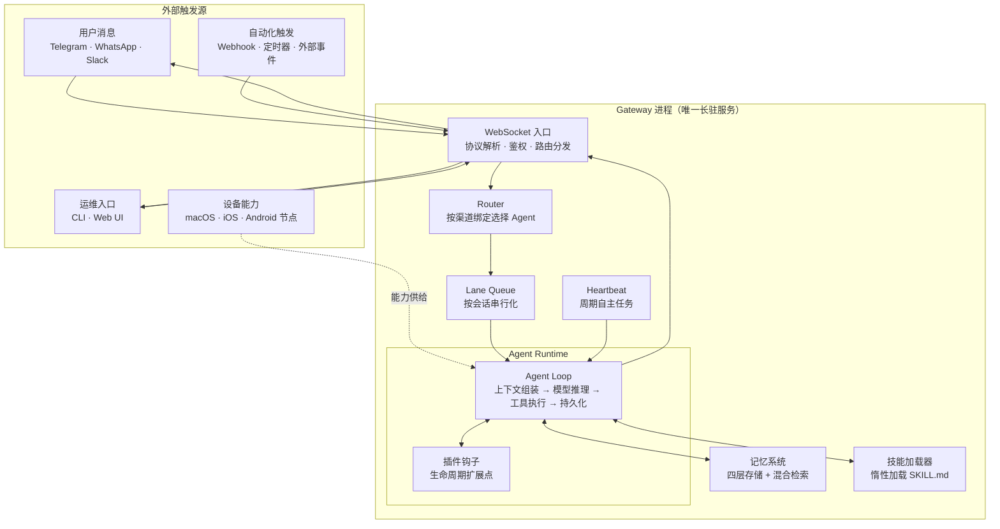
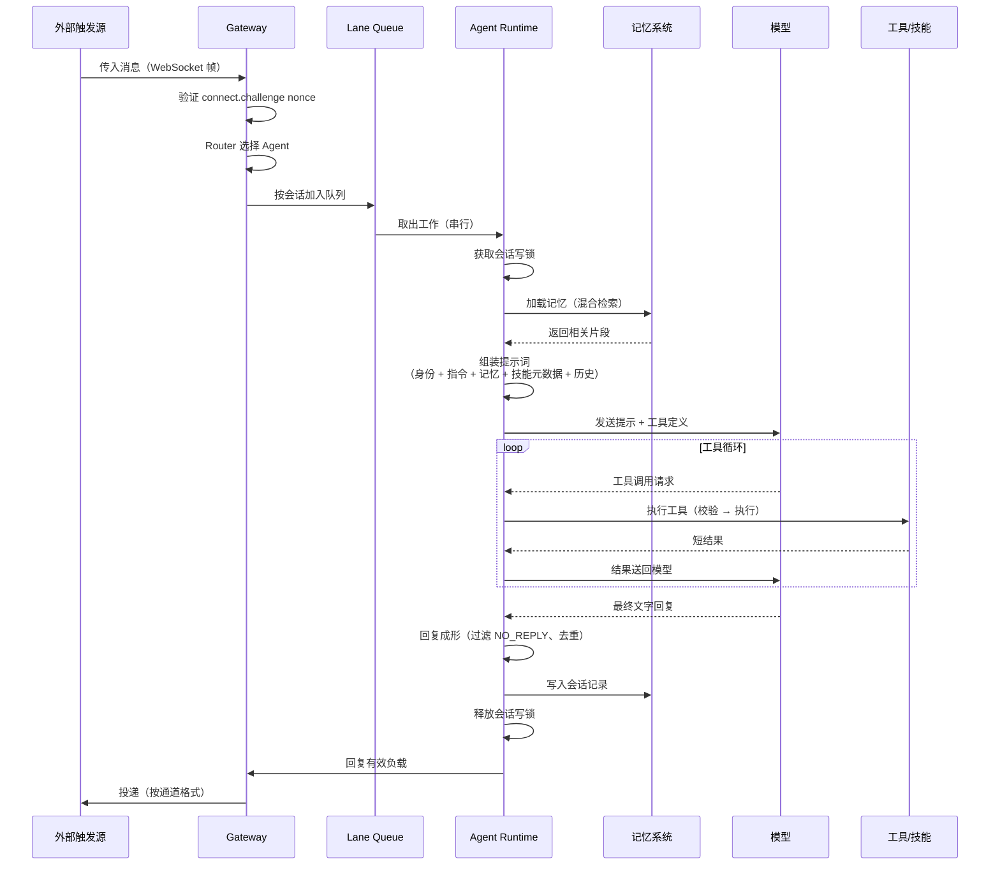

# 智能体架构

> 面向开源开发者的技术文档。以 OpenClaw 为参考，描述一个常驻运行时如何组织通道、控制平面、执行引擎、记忆与技能系统，使无状态的大语言模型表现出有状态、持续运行的智能体行为。

---

## 一、设计起点

大语言模型本质上是 `f(prompt) → response` 的无状态函数。它不记得上一轮说了什么，不知道磁盘上有什么文件，也不认识某个通道的用户编号。

**架构要解决的核心矛盾：如何让无状态的 LLM 表现出有状态、持续运行的智能体行为？**

OpenClaw 的答案：

> **模型只负责判断，运行时握住状态。** 通道、日程、权限、磁盘由运行时管理；一切能力通过外部扩展注入，不修改核心。

---

## 二、总体架构

OpenClaw 是**单进程、Gateway 中心**的架构。一个长驻进程同时承担控制平面和执行引擎，所有外部连接汇聚到同一个 WebSocket 入口。



**三个设计决策：**

| 决策 | 说明 |
| --- | --- |
| **单进程** | 无微服务、无容器、无进程间通信复杂度；事件循环自然处理并发 |
| **Gateway 唯一入口** | 所有外部连接（IM、CLI、节点、自动化）都通过 WebSocket 接入 |
| **模型与运行时分离** | 模型是「大脑」，运行时是「手和记忆」 |

---

## 三、外部触发源

外部按**角色**分四类，产品名只作为例子：

| 角色 | 是什么 | 特点 | 例子 |
| --- | --- | --- | --- |
| **用户消息** | 人主动发起的对话 | 被动触发，恢复会话 | Telegram、WhatsApp、Slack |
| **自动化触发** | 程序或时间发起的事件 | 主动触发，独立短会话 | Webhook 回调、Cron 定时、外部系统事件 |
| **运维入口** | 人来管理 Agent 的界面 | 不产生对话，改配置/状态 | CLI、Web UI |
| **设备能力** | 远端设备提供的能力 | 不是消息，是**能力供给** | macOS 截图、iOS 摄像头、Android SMS |

**关键区分：**

- 前三类是**往 Gateway 送工作**（输入）。
- 第四类是**给 Gateway 提供能力**（外设）——设备节点不是发消息的，是让 Agent 能操作远端设备的。

---

## 四、逻辑分层

从请求处理的角度，系统划分为**六层**：

### 4.1 通道层（Channels）

**职责：** 收进原始消息，送出要给人看的文字或动作。

- 支持多个消息平台桥接（Telegram、WhatsApp、Slack、Discord、Signal、iMessage、WebChat 等）
- 每个通道是一个独立的连接适配器
- 通道不认识模型的接口，只认识 Gateway 的 WebSocket 协议

### 4.2 网关层（Gateway）

**职责：** 把通道事件变成一条工作，把回复投递回通道。

| 子组件 | 职责 |
| --- | --- |
| **WebSocket 服务器** | 接受所有连接，解析 JSON 帧，验证 `connect` 握手 |
| **鉴权** | 共享密钥、Tailscale 身份、设备配对 |
| **Router** | 按渠道绑定、账户、内容规则选择目标 Agent |
| **Lane Queue** | 按会话串行化执行，防止状态交错 |
| **会话写锁** | 进程感知、文件基础，检测绕过队列的写入者 |

**协议：**

```
Client → { type: "req", id, method, params }
Gateway → { type: "res", id, ok, payload|error }
Gateway → { type: "event", event, payload }   // server-push
```

幂等键：副作用方法（`send`、`agent`）必须携带幂等键，服务器维护短期去重缓存。

### 4.3 执行层（Agent Runtime）

**职责：** 握住一轮工作的完整生命周期。

Agent Loop 是**权威执行路径**：

```
接收 → 上下文组装 → 模型推理 → 工具执行 → 流式回复 → 持久化
```

**执行顺序：**

1. `agent` RPC 验证参数，解析会话（`sessionKey`/`sessionId`），持久化会话元数据，立即返回 `{ runId, acceptedAt }`
2. `agentCommand` 解析模型和思考/详细模式默认值，加载 Skills 快照
3. `runEmbeddedAgent`：
   - 通过每会话队列 + 全局队列序列化执行
   - 解析模型和认证配置文件
   - 构建 OpenClaw 会话
   - 订阅运行时事件，流式传输助手/工具增量
   - 强制执行超时 → 超时则中止
   - 返回有效负载和使用元数据

**事件流：**

| 流 | 内容 |
| --- | --- |
| `lifecycle` | phase: start / end / error |
| `assistant` | 助手输出的增量 |
| `tool` | 工具事件的流式传输 |

**工具循环：** 模型要调用工具时，宿主执行、把短结果送回模型再问下一次；模型不再要工具、只给出文字时，一轮结束。

### 4.4 能力层（Tools / Skills / Plugins）

OpenClaw 用**三层能力界面**组织 Agent 能做什么：

| 层 | 是什么 | 何时用 |
| --- | --- | --- |
| **工具** | 可调用的类型化函数 | Agent 需要执行操作 |
| **技能** | `SKILL.md` 指令包，加载到提示词中 | Agent 已有工具，但需要可重复的工作流 |
| **插件** | 可安装的软件包，可注册工具、技能、渠道、提供商、钩子 | 需要新运行时能力 |

**工具策略：**

- 模型只能看到经过配置文件、允许/拒绝策略、提供商限制、沙箱状态、渠道权限、插件可用性筛选后保留的工具
- `tools.profile` 设置基础允许列表：`full`（默认）、`coding`、`messaging`
- `tools.byProvider` 可按提供商限制工具

**技能惰性加载：** 提示词中只放入技能的元数据列表（名称、描述、位置），模型判断需要时才通过 `read` 工具加载完整 `SKILL.md`。

### 4.5 记忆层（Memory）

**职责：** 在模型外面保管状态，按需取出少量内容放进提示。

OpenClaw 的记忆系统包含**四层**：

| 层 | 内容 | 维护方式 |
| --- | --- | --- |
| **会话上下文** | 当前会话的交互记录 | 窗口内自动加载 |
| **每日日志** | 每日原始对话日志 | 自动追加写入 |
| **长期记忆** | 持久事实、决策、偏好 | 人工维护（`MEMORY.md`） |
| **语义检索** | 相关历史片段 | 向量存储，按需检索 |

**上下文组装的分层预算：**

| 层 | 来源 | 典型大小 |
| --- | --- | --- |
| 系统身份 | `SOUL.md` | 200–1,000 tokens |
| Agent 指令 | `AGENTS.md`、`TOOLS.md` | 100–500 tokens |
| 记忆 | 混合检索结果 | 最多 2,000 tokens |
| 活跃技能 | `SKILL.md` | 每技能 100–500 tokens |
| 对话历史 | 近期消息 | 随会话增长 |
| 渠道消息 | 传入消息 | 可变 |

**压缩（Compaction）：** 当上下文接近窗口上限时，先通过 LLM 摘要提炼，沉淀到长期记忆，再执行裁剪。

### 4.6 持久化层（State）

**职责：** 进程重启后仍在。

| 存储 | 位置 | 内容 |
| --- | --- | --- |
| 主配置 | `~/.openclaw/openclaw.json` | gateway、brain、hands、channels、plugins |
| 身份 | `~/.openclaw/SOUL.md` | Agent 身份和人格 |
| 指令 | `~/.openclaw/AGENTS.md` | 任务指令和操作规则 |
| 记忆 | `~/.openclaw/memory/` | 持久记忆文件 |
| 凭据 | `~/.openclaw/credentials/` | 每渠道认证凭据 |
| 技能 | `~/.openclaw/skills/` | 已安装技能文件 |

---

## 五、插件钩子

### 5.1 为什么需要钩子

Agent Loop 是一个**稳定的核心循环**。如果每个新需求都直接改核心代码，核心会越来越臃肿，插件也无法独立演进。

**钩子（Hooks）**就是让外部代码在**核心流程的特定时机插入逻辑**的扩展点。核心循环照常跑，插件在指定位置「挂钩」自己的代码。

```
没有钩子：                  有钩子：
核心循环                    核心循环
  ↓                          ↓
（只能改核心才能扩展）        ├── 钩子点 1 ← 插件 A 插入
                            ├── 钩子点 2 ← 插件 B 插入
                            ├── 钩子点 3 ← 插件 C 插入
                            ↓
                          （核心不变，插件扩展）
```

### 5.2 钩子插在哪些时机

| 钩子 | 执行时机 | 典型用途 |
| --- | --- | --- |
| **`before_model_resolve`** | 会话开始前，模型还没选定 | 按规则覆盖供应商/模型 |
| **`agent:bootstrap`** | 系统提示定稿前 | 动态增删引导内容 |
| **`before_tool_call`** | 工具调用前 | 拦截参数、审查危险操作、改写命令 |
| **`after_tool_call`** | 工具调用后 | 过滤结果、记录审计、转换格式 |
| **`message_received`** | 入站消息到达时 | 预处理、分类、触发额外逻辑 |
| **`message_sending`** | 出站消息发送前 | 敏感词过滤、格式改写、添加签名 |
| **`message_sent`** | 出站消息发送后 | 记录、统计、触发下游动作 |

### 5.3 三个具体例子

**例子 1：`before_model_resolve` 按用户路由模型**

```
if user.plan == "free":
    return { provider: "openai", model: "gpt-4o-mini" }
else:
    return { provider: "anthropic", model: "claude-opus-4" }
```

**例子 2：`before_tool_call` 拦截危险命令**

```
if tool.name == "Bash" and "rm -rf" in tool.args.command:
    return { blocked: true, reason: "危险命令被拦截" }
```

**例子 3：`agent:bootstrap` 按场景注入身份**

```
if session.scene == "group":
    append_file("SOUL-group.md")
else:
    append_file("SOUL-private.md")
```

### 5.4 两套钩子的区别

| 系统 | 是什么 | 什么时候用 |
| --- | --- | --- |
| **内部钩子（Gateway Hooks）** | 命令和生命周期事件的事件驱动脚本 | 响应 `/new`、`/reset`、`/stop` 这类命令 |
| **插件钩子（Plugin Hooks）** | Agent/工具生命周期和 Gateway 管道中的扩展点 | 在 `before_tool_call` 这类时机插入逻辑 |

### 5.5 钩子与工具、技能的区别

| 维度 | 工具 | 技能 | 钩子 |
| --- | --- | --- | --- |
| **谁决定用** | 模型 | 模型 | 插件代码 |
| **何时执行** | 模型点名时 | 模型读说明后 | 核心流程固定时机 |
| **能否拒绝** | 模型可以不用 | 模型可以不读 | 在流程中自动执行 |
| **典型用途** | 执行操作 | 教工作流 | 拦截、改写、审计、路由 |

**一句话区分：**

- **工具**：模型想做什么。
- **技能**：模型该怎么做。
- **钩子**：不管模型想不想，核心流程到这一步就会执行插件逻辑。

---

## 六、完整请求流程

从一条消息到最终回复的完整路径：



**关键路径节点：**

| 步骤 | 做什么 | 为什么 |
| --- | --- | --- |
| 鉴权 | 验证 `connect.challenge` nonce 签名 | 防止未授权连接 |
| Router | 按渠道绑定选择 Agent | 多 Agent 隔离上下文 |
| 队列 | 按会话串行化 | 防止状态交错 |
| 写锁 | 进程感知文件锁 | 防止跨进程写入 |
| 记忆检索 | 混合搜索（近期 + 语义） | 只取相关片段，不塞全文 |
| 技能加载 | 只放元数据 | 控制上下文开销 |
| 工具循环 | 串行执行，结果回送 | 下一步依赖上一步 |
| 回复成形 | 过滤 `NO_REPLY`、去重 | 避免静默标记外泄 |

---

## 七、自主运行机制

OpenClaw 的 Heartbeat 让 Agent 在无人对话时仍能主动工作。

```
Heartbeat 周期触发
        ↓
组装短提示（含 HEARTBEAT.md 清单）
        ↓
调用模型判断「有没有需要人知道的事」
        ↓
有 → 发消息   无 → 静默（NO_REPLY）
```

**与用户对话的区别：**

| 维度 | 用户对话 | Heartbeat |
| --- | --- | --- |
| 触发 | 用户发消息 | 周期定时 |
| 会话 | 恢复日常会话 | 独立短会话 |
| 上下文 | 带近期历史 | 只带清单 |
| 无事时 | 不适用 | 静默不发 |

---

## 八、核心设计原则

| 原则 | 说明 |
| --- | --- |
| **模型无状态，运行时握状态** | 通道、日程、权限、磁盘由运行时管理 |
| **单进程 Gateway** | 无微服务、无 IPC 复杂度，垂直扩展为主 |
| **本地优先** | 所有数据留磁盘，除 LLM API 外无云依赖 |
| **模型无关** | 换提供商只改配置行；不同任务路由不同模型 |
| **单写者正确性** | 每会话同时只跑一轮，队列 + 写锁双重保护 |
| **惰性加载技能** | 提示词只放元数据，完整说明按需读取 |
| **上下文预算分层** | 身份 > 知识 > 历史 > 工具回执，牺牲顺序明确 |
| **压缩优先于丢弃** | 接近窗口上限时先摘要提炼，沉淀长期记忆 |
| **钩子扩展核心** | 核心稳定，插件在固定时机插入逻辑 |
| **外部内容标记** | 外部内容包裹 `EXTERNAL_UNTRUSTED_CONTENT` 边界标记 |

---

## 九、一句话总结

> OpenClaw 的架构是一个 **Gateway 中心的单进程系统**：外部触发源（用户消息、自动化、运维入口、设备能力）通过 WebSocket 汇聚到 Gateway，Gateway 鉴权路由，Lane Queue 按会话串行化，Agent Loop 执行「上下文组装 → 模型推理 → 工具循环 → 流式回复 → 持久化」，记忆和技能在模型外面按需供给。
>
> **插件钩子**让核心保持稳定——在 `before_model_resolve`、`before_tool_call`、`agent:bootstrap`、`message_received/sending/sent` 等位置插入路由、拦截、改写、审计逻辑。**工具是模型想做什么，技能是模型该怎么做，钩子是不管模型想不想，核心流程到这一步就执行插件逻辑。**
>
> **模型只负责判断，运行时握住状态；一切能力通过工具、技能、插件三层界面注入，核心保持稳定。**