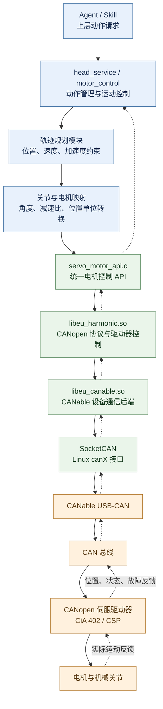
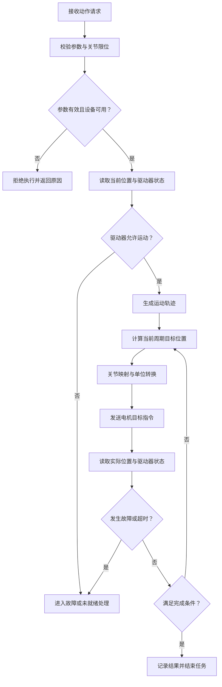
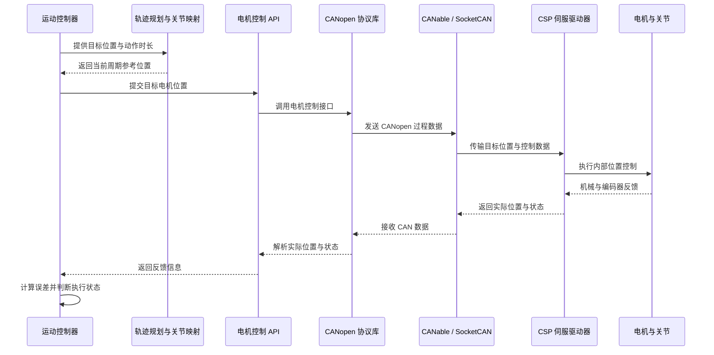

# 机器人运动控制与电机驱动架构

## 1. 文档概述

### 1.1 文档目的

本文介绍机器人从上层动作请求到伺服电机执行的完整控制架构，重点说明运动控制、轨迹规划、关节与电机映射、CANopen 通信、CiA 402 驱动器状态机、CSP 周期同步位置控制及状态反馈之间的关系。

通过分层设计，将上层运动需求转换为驱动器能够执行的位置指令，并通过状态反馈、异常检测和安全停止机制形成完整的控制闭环。

### 1.2 设计目标

- **统一控制入口**：通过电机控制 API 向底层设备发送控制请求。
- **解耦运动规划与硬件实现**：轨迹规划不直接依赖 CAN 报文或具体通信设备。
- **统一数据转换**：明确关节角度、电机旋转量及驱动器位置单位之间的转换关系。
- **支持周期位置控制**：通过 CANopen PDO 等机制向支持 CSP 的驱动器更新目标位置。
- **完善状态反馈**：监测实际位置、驱动器状态、通信异常及动作执行结果。
- **明确安全边界**：区分普通软件停止、驱动器快速停止与独立安全功能。

### 1.3 适用范围

本文覆盖以下技术层次：

1. 上层动作请求与运动控制。
2. 轨迹规划与关节运动学映射。
3. 电机控制 API 与协议库。
4. CANable、SocketCAN 与 CAN 总线。
5. CANopen 通信及 CiA 402 驱动器控制。
6. CSP 位置执行、状态反馈与故障处理。

文中涉及的具体接口和配置以当前项目描述为依据。对象字典、PDO 映射、驱动器位置单位及安全功能的实际配置，应以设备手册和项目源码为准。

---

## 2. 系统总体架构

### 2.1 架构分层

系统采用分层控制架构，将上层动作决策、运动规划、设备控制、通信协议和硬件执行分离。



图中实线表示主要指令链路，虚线表示反馈链路。反馈路径用于上层判断运动状态和执行结果；实际系统中，各层的调用方式可能是同步调用、周期任务或独立线程，具体以代码实现为准。

### 2.2 各模块职责

| 模块 | 核心职责 | 不应承担的职责 |
|---|---|---|
| Agent / Skill | 生成动作请求及目标参数 | 直接操作 CAN 总线 |
| `head_service / motor_control` | 管理动作生命周期、执行状态及异常处理 | 实现底层 CAN 报文细节 |
| 轨迹规划模块 | 生成满足运动约束的目标轨迹 | 管理 USB-CAN 设备 |
| 关节与电机映射模块 | 进行关节角度、电机位置和驱动器单位换算 | 负责通信状态机 |
| `servo_motor_api.c` | 提供统一的电机控制接口 | 直接承担上层动作决策 |
| `libeu_harmonic.so` | 处理 CANopen 指令、驱动器控制及状态解析 | 决定上层动作语义 |
| `libeu_canable.so` | 对接 CANable 设备及 SocketCAN 通信 | 实现完整运动规划 |
| 伺服驱动器 | 根据设定模式执行底层运动控制 | 替代上层动作管理与协调 |

**架构原则：** 上层模块负责决定“运动到哪里、如何运动、何时结束”；底层协议模块负责“如何与驱动器通信”；驱动器负责“如何执行位置控制”。

---

## 3. 运动控制与轨迹规划

### 3.1 动作执行流程

一次完整的运动任务通常经历以下阶段：

1. **接收请求**：获取目标关节角度、动作时长及相关参数。
2. **参数校验**：检查关节限位、参数有效性、设备可用性及驱动器状态。
3. **获取初始状态**：读取实际位置、运行状态及必要的速度信息。
4. **生成轨迹**：根据起始状态、目标状态和运动约束生成参考轨迹。
5. **周期更新**：根据轨迹时间计算当前周期的目标位置。
6. **坐标映射**：将关节目标转换为电机或驱动器使用的位置单位。
7. **发送指令**：通过电机控制 API 和 CANopen 通信链路发送目标。
8. **监测反馈**：读取实际位置、驱动器状态及故障信息。
9. **判断完成**：根据位置误差、运动状态、稳定时间和超时条件判断结果。
10. **结束任务**：返回成功、失败、取消或超时等执行结果。

### 3.2 动作控制流程图



### 3.3 五次多项式轨迹

对于起始位置为 $q_0$、目标位置为 $q_f$、持续时间为 $T$，且起止速度和加速度均为零的单段运动，可以采用五次多项式进行插值。

定义归一化时间：

$$
s=\operatorname{clamp}\left(\frac{t}{T},0,1\right)
$$

目标位置为：

$$
q(t)=q_0+(q_f-q_0)(10s^3-15s^4+6s^5)
$$

其中：

- $q_0$：起始位置。
- $q_f$：目标位置。
- $T$：轨迹持续时间。
- $t$：当前轨迹时间。
- $s$：归一化时间，范围为 0 到 1。

该轨迹在起点和终点具有零速度、零加速度，适用于平滑的位置运动。

但五次多项式并不自动保证所有设备约束均满足。生成轨迹后，仍需检查最大速度、最大加速度、最大加加速度（如有要求）、关节限位及机械干涉。

对于点头、摆动等复合动作，应将动作拆分为多个阶段，并明确每个阶段的目标位置、持续时间、衔接条件及多轴同步要求。

### 3.4 控制周期的区别

系统中存在多个不同的时间尺度：

| 时间尺度 | 含义 |
|---|---|
| 动作持续时间 | 一次动作从开始到目标状态的计划时长 |
| 轨迹更新周期 | 控制器重新计算参考轨迹的时间间隔 |
| 通信发送周期 | 控制器发送目标位置或过程数据的时间间隔 |
| 驱动器内部控制周期 | 驱动器内部位置、速度和电流控制的执行周期 |

这些周期不一定相同。特别是在 CSP 模式下，主站更新目标位置的周期必须与驱动器配置、PDO 通信机制和系统实时性要求相匹配。

---

## 4. 关节与电机位置映射

### 4.1 减速比换算

定义减速比：

$$
R=\frac{\text{电机转速}}{\text{关节输出转速}}
$$

在忽略零点偏移、传动方向及机械误差时，电机旋转圈数与关节角度之间的关系为：

$$
N_{\text{motor}}=\frac{\theta_{\text{joint}}R}{360}
$$

反向转换为：

$$
\theta_{\text{joint}}=\frac{360N_{\text{motor}}}{R}
$$

其中：

- $\theta_{\text{joint}}$：关节角度，单位为度。
- $N_{\text{motor}}$：电机旋转圈数。
- $R$：减速比。

**示例：** 减速比为 50:1，关节目标旋转 30°，则电机需要旋转：

$$
N_{\text{motor}}=\frac{30\times50}{360}
\approx4.1667\text{ 转}
$$

该结果是理想传动关系下的换算值，不包含实际零点偏移及机械误差。

### 4.2 编码器计数换算

若每个电机转对应 $C$ 个有效位置计数，则：

$$
\theta_{\text{joint}}=
\frac{360\times\text{count}}{C\times R}
$$

该公式仅适用于已明确计数定义、零点和方向的情况。

实际系统需要确认：

- 编码器每转计数与驱动器位置单位的定义。
- 编码器计数是否包含四倍频、电子齿轮或其他倍率。
- 电机零点、关节零点及方向约定。
- 单圈或多圈位置的表示方式。
- 机械减速比与驱动器内部换算参数。

### 4.3 推荐的映射接口

建议将关节映射集中封装为独立模块，避免在运动控制逻辑和协议代码中重复计算。

逻辑接口示例：

```text
joint_to_motor_position(joint_position)
    -> motor_position

motor_to_joint_position(motor_position)
    -> joint_position
```

映射模块应统一处理减速比、方向、零点偏移及驱动器位置单位。若系统包含非线性传动或多关节耦合，还需使用对应的运动学模型，而不能仅依靠简单减速比换算。

---

## 5. CANopen 通信与驱动器控制

### 5.1 通信硬件与软件链路

当前通信链路为：

```text
servo_motor_api.c
       |
       v
libeu_harmonic.so
       |
       v
libeu_canable.so
       |
       v
Linux SocketCAN（canX）
       |
       v
CANable USB-CAN
       |
       v
CAN 总线
       |
       v
CANopen 伺服驱动器
```

其中：

- `servo_motor_api.c`：上层电机控制入口。
- `libeu_harmonic.so`：处理 CANopen 指令、驱动器控制及反馈解析。
- `libeu_canable.so`：提供 CANable 设备通信后端。
- SocketCAN：Linux CAN 通信接口。
- CANable：连接主机与 CAN 总线的 USB-CAN 设备。

### 5.2 初始化配置

当前初始化接口为：

```c
harmonic_initDLL(
    harmonic_DeviceType_Canable,
    devIndex_0,
    harmonic_Baudrate_1000
);
```

当前配置如下：

| 配置项 | 当前值 | 说明 |
|---|---|---|
| 设备类型 | `harmonic_DeviceType_Canable` | 使用 CANable 设备后端 |
| 设备索引 | `devIndex_0 = 1` | 具体含义由设备库实现决定 |
| CAN 波特率 | `harmonic_Baudrate_1000` | 对应 1 Mbps |

设备索引不应直接等同于 Linux 的 `can0` 或 `can1`。实际使用的 SocketCAN 接口，应根据后端实现和运行配置确认。

### 5.3 CANopen 通信机制

| 机制 | 用途 |
|---|---|
| SDO | 读写对象字典，用于参数配置和状态查询 |
| PDO | 传输目标位置、实际位置、控制字和状态字等过程数据 |
| NMT | 管理 CANopen 节点的网络状态 |
| Heartbeat | 监测节点的通信存活状态 |
| SYNC | 在相应设备和配置支持时，协调同步通信 |

需要注意：

- PDO 本身不保证周期同步。
- SYNC 机制需要主站、驱动器及相关通信配置共同支持。
- Heartbeat 正常不等于驱动器已经允许运动。
- CAN 通信正常不等于机械运动正常。
- 周期同步能力还受主机调度、USB-CAN 传输、总线负载及驱动器实现影响。

### 5.4 位置指令发送

当前实现使用以下接口及配置：

| 项目 | 当前描述 |
|---|---|
| 发送接口 | `harmonic_writeCanData()` |
| CAN 标识符 | `0x200 + id` |
| 对应通信对象 | RPDO1 |
| 目标位置对象 | `0x607A` |

`0x607A` 是 CiA 402 目标位置对象。它是否通过 RPDO1 传输，取决于驱动器实际 PDO 映射。

因此，项目验证时应确认：

1. CAN 标识符与节点地址配置一致。
2. PDO 映射包含所需的目标位置和控制数据。
3. 报文长度、数据布局、字节序及数据类型正确。
4. 目标位置采用驱动器实际支持的位置单位。
5. 发送周期与驱动器运行模式相匹配。

不能仅凭 CAN 标识符或接口调用成功，就认定目标位置已被驱动器正确接受。

### 5.5 CiA 402 驱动器状态机

CiA 402 定义了驱动器状态机、控制对象及运动控制模式。驱动器需要进入正确状态后，才能执行相应的运动控制。

常见对象如下：

| 索引 | 对象名称 | 作用 |
|---|---|---|
| `0x6040` | Controlword | 控制字，用于请求驱动器状态转换 |
| `0x6041` | Statusword | 状态字，用于读取驱动器当前状态 |
| `0x6060` | Modes of operation | 目标操作模式 |
| `0x6061` | Modes of operation display | 当前操作模式显示 |
| `0x607A` | Target position | 目标位置 |
| `0x6064` | Position actual value | 实际位置 |

典型初始化和启动流程：

1. 初始化 CANopen 通信。
2. 检查节点通信状态。
3. 读取驱动器状态字并检查故障。
4. 按照 CiA 402 状态转换规则发送控制字。
5. 确认驱动器进入允许运行的状态。
6. 设置操作模式，并确认模式显示值。
7. 按照模式要求发送目标位置。
8. 持续监测状态字、实际位置及故障信息。

**重要区别：** CANopen NMT 网络状态与 CiA 402 驱动器状态是两个不同的状态体系。节点进入 NMT Operational，不代表驱动器已经进入 Operation enabled。

---

## 6. CSP 周期同步位置控制

### 6.1 控制原理

CSP（Cyclic Synchronous Position，周期同步位置模式）是一种由主控制器周期性更新目标位置、由驱动器执行位置控制的运行模式。

主控制器负责计算参考位置并按照控制周期发送目标；驱动器根据目标位置和内部反馈执行相应的控制。具体的速度、加速度及电流控制由驱动器内部实现及配置决定。

### 6.2 CSP 控制链路



### 6.3 CSP 实施要求

启用 CSP 前，应确认：

- 驱动器支持 CSP，且当前运行模式配置正确。
- 驱动器已经进入允许运行的状态。
- 目标位置与实际位置使用一致的单位和符号约定。
- PDO 映射与目标数据格式正确。
- 主站更新周期满足驱动器要求。
- 通信延迟、周期抖动及总线负载在允许范围内。
- 多轴运动具有满足需求的同步机制。
- 通信中断、驱动器故障及目标丢失时具有明确的处置策略。

CSP 是驱动器运行模式，不等于整个系统天然具备硬实时能力。系统的实际同步性能取决于主站调度、通信链路和驱动器实现。

---

## 7. 状态反馈与动作完成判定

### 7.1 反馈数据

建议统一采集以下信息：

| 数据类型 | 主要用途 |
|---|---|
| 目标位置 | 判断当前控制器期望状态 |
| 实际位置 | 判断电机与关节的实际运动状态 |
| 位置误差 | 判断跟踪偏差 |
| 实际速度（如可用） | 判断运动是否趋于停止 |
| 驱动器状态字 | 判断驱动器是否就绪、允许运行或发生故障 |
| 当前操作模式 | 确认驱动器实际运行模式 |
| 通信状态 | 判断节点及通信链路是否正常 |
| 故障信息 | 支持诊断和异常处理 |

位置误差定义为：

$$
e(t)=q_{\text{target}}(t)-q_{\text{actual}}(t)
$$

目标位置与实际位置必须处于同一坐标系和单位体系中，才能进行有效比较。

### 7.2 动作完成条件

建议结合以下条件判断动作是否完成：

- 实际位置与最终目标位置的误差进入允许范围。
- 实际速度低于停止阈值（若可获取）。
- 驱动器处于正常且允许的状态。
- 上述条件持续满足指定时间。
- 未发生通信故障、驱动器故障或执行超时。

单次位置接近目标并不足以确认动作完成。对于存在机械振动、回弹或负载扰动的关节，应考虑稳定时间和反馈有效性。

### 7.3 执行状态的区分

需要严格区分三个阶段：

1. **命令发送成功**：主机侧完成了相应的发送操作。
2. **驱动器接受并执行命令**：驱动器处于适当状态，并按配置处理目标。
3. **实际运动完成**：实际位置和运动状态满足完成判定条件。

这三个阶段并不等价。上层动作接口应根据实际反馈返回执行结果，而不是仅依据底层发送函数的返回值判断成功。

---

## 8. 故障处理与安全边界

### 8.1 异常处理策略

| 异常类型 | 建议处理原则 |
|---|---|
| 目标角度超限 | 拒绝请求，或按照明确的限幅策略处理 |
| 驱动器未就绪 | 禁止启动运动，并记录状态原因 |
| CAN 通信中断 | 停止依赖无效反馈，并执行预定义故障策略 |
| 反馈数据异常 | 标记数据无效，避免使用错误状态继续控制 |
| 动作执行超时 | 结束任务并进入异常处理流程 |
| 驱动器故障 | 读取故障信息，根据设备要求执行故障处理 |
| 用户取消动作 | 根据当前状态执行受控停止，并确认结果 |
| 急停请求 | 触发系统规定的安全机制 |

具体处置动作应根据机械负载、驱动器能力及整机风险评估确定，不应将所有故障统一处理为简单的停止发送。

### 8.2 停止机制的区别

| 停止方式 | 主要含义 |
|---|---|
| 普通软件停止 | 应用层停止当前动作或生成停止轨迹 |
| CiA 402 Quick Stop | 根据驱动器配置执行快速停止相关状态转换 |
| 硬件急停 | 由整机安全设计规定的急停机制触发 |
| STO（Safe Torque Off） | 由具备相应安全能力的硬件及系统实现的安全转矩关闭功能 |

普通软件停止、Quick Stop、硬件急停及 STO 不能相互替代。尤其是通信中断或主机软件失效时，不能仅依赖普通应用程序发送停止指令来保证安全。

---

## 9. 软件模块组织建议

建议按照职责组织控制软件，逻辑结构如下：

```text
motion_control/
├── controller/
│   └── motion_controller
├── trajectory/
│   └── trajectory_planner
├── kinematics/
│   ├── joint_mapping
│   └── encoder_conversion
├── hardware/
│   └── servo_motor_api
├── protocols/
│   └── harmonic_canopen
├── feedback/
│   └── state_monitor
├── safety/
│   └── fault_handler
└── config/
    ├── motor_config
    └── joint_limits
```

模块说明：

- `controller`：管理动作请求、执行状态及任务生命周期。
- `trajectory`：生成参考位置轨迹，并检查运动约束。
- `kinematics`：处理关节与电机之间的映射。
- `hardware`：提供统一的电机操作接口。
- `protocols`：封装 CANopen 通信和驱动器控制。
- `feedback`：维护实际位置、状态及执行完成判定所需的信息。
- `safety`：处理故障策略、停止请求和异常状态。
- `config`：集中管理电机参数、减速比、零点和关节限位。

以上为逻辑模块划分，不要求与现有源码文件或动态库一一对应。实施时应优先复用现有代码，避免为了形式上的分层增加不必要的抽象。

---

## 10. 关键设计约束与验证清单

在系统集成和故障排查过程中，建议重点验证以下项目。

| 检查项 | 验证目标 |
|---|---|
| 初始化 | 设备、波特率、节点地址与通信接口配置正确 |
| 驱动器状态 | 状态字及控制字转换符合 CiA 402 要求 |
| 操作模式 | 驱动器实际运行模式与控制器预期一致 |
| 位置单位 | 关节、电机和驱动器的位置换算一致 |
| PDO 配置 | CAN 标识符、映射对象、数据布局及长度正确 |
| 轨迹约束 | 目标轨迹满足位置、速度和加速度限制 |
| 周期性能 | 指令更新周期和通信抖动满足驱动器要求 |
| 反馈有效性 | 实际位置、状态和故障信息能够正确解析 |
| 完成判定 | 不以命令发送成功代替实际动作完成 |
| 异常处理 | 通信中断、执行超时及驱动器故障均有明确策略 |
| 安全功能 | 急停及 STO 等功能符合整机安全设计要求 |

---

## 11. 总结

机器人运动控制系统通过分层架构，将上层动作请求转换为驱动器可执行的位置目标，并通过反馈信息完成执行状态监测。

其核心链路为：

**动作请求 → 运动控制 → 轨迹规划 → 关节映射 → 电机控制 API → CANopen 协议处理 → CANable / SocketCAN → CSP 伺服驱动器 → 电机执行。**

反馈信息沿相反方向返回，用于位置误差计算、状态监测、动作完成判定和故障处理。

其中，运动控制模块负责动作生命周期与执行策略，轨迹规划模块负责生成参考位置，关节映射模块负责坐标和单位转换，`libeu_harmonic.so` 负责 CANopen 协议及驱动器控制，`libeu_canable.so` 负责底层设备通信，伺服驱动器负责实际的位置控制。

整个系统的可靠性不仅取决于指令能否发送，还取决于状态机配置、位置单位一致性、通信周期、反馈有效性和安全机制是否经过完整验证。
