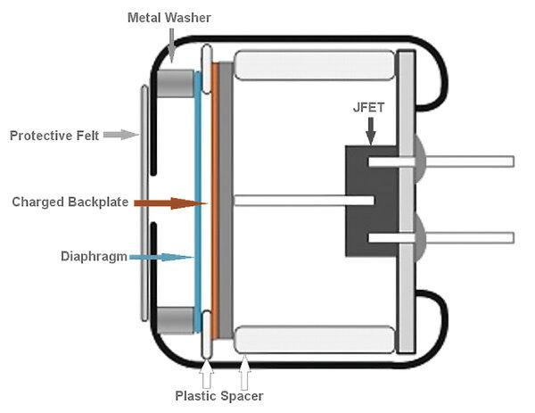
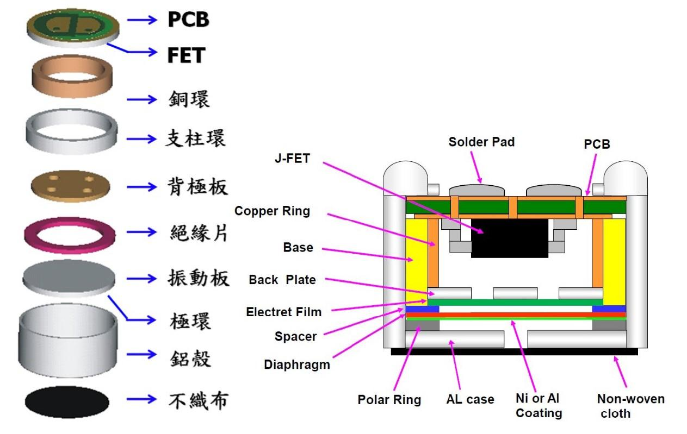
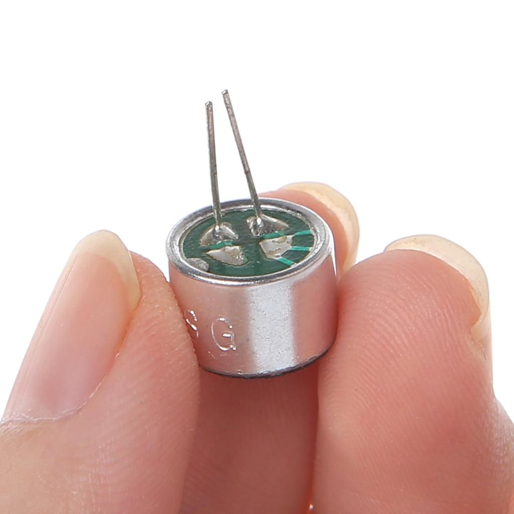
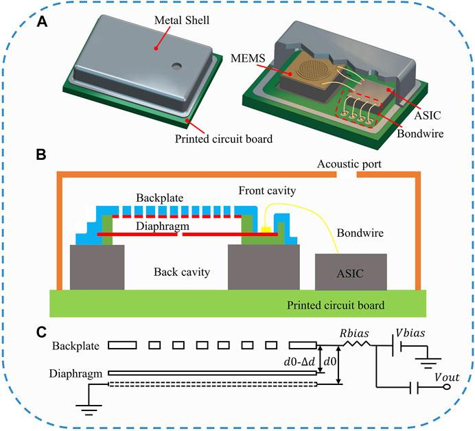
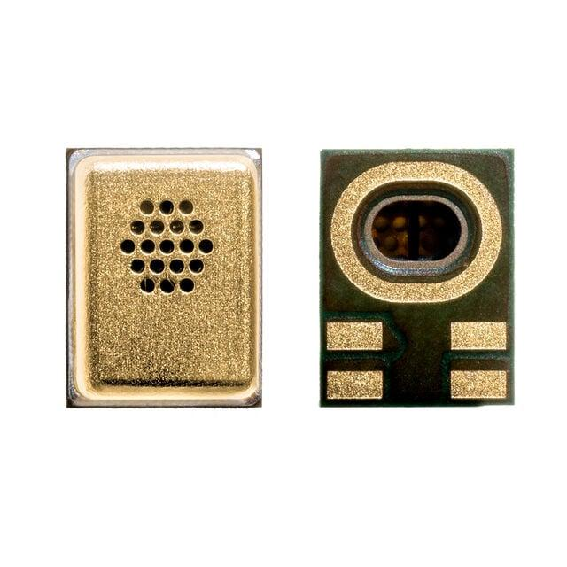
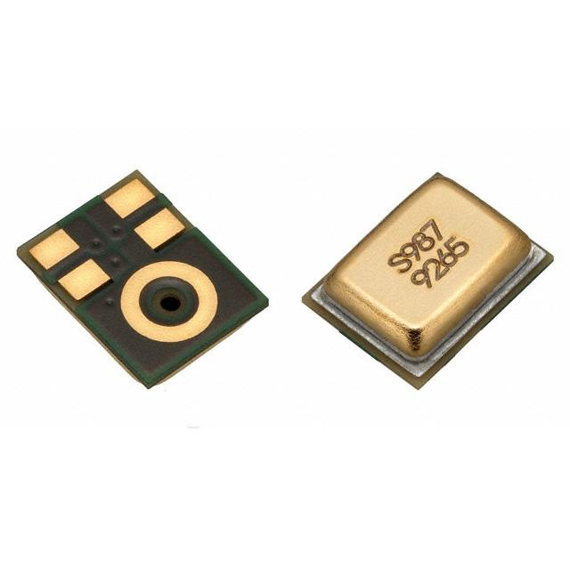
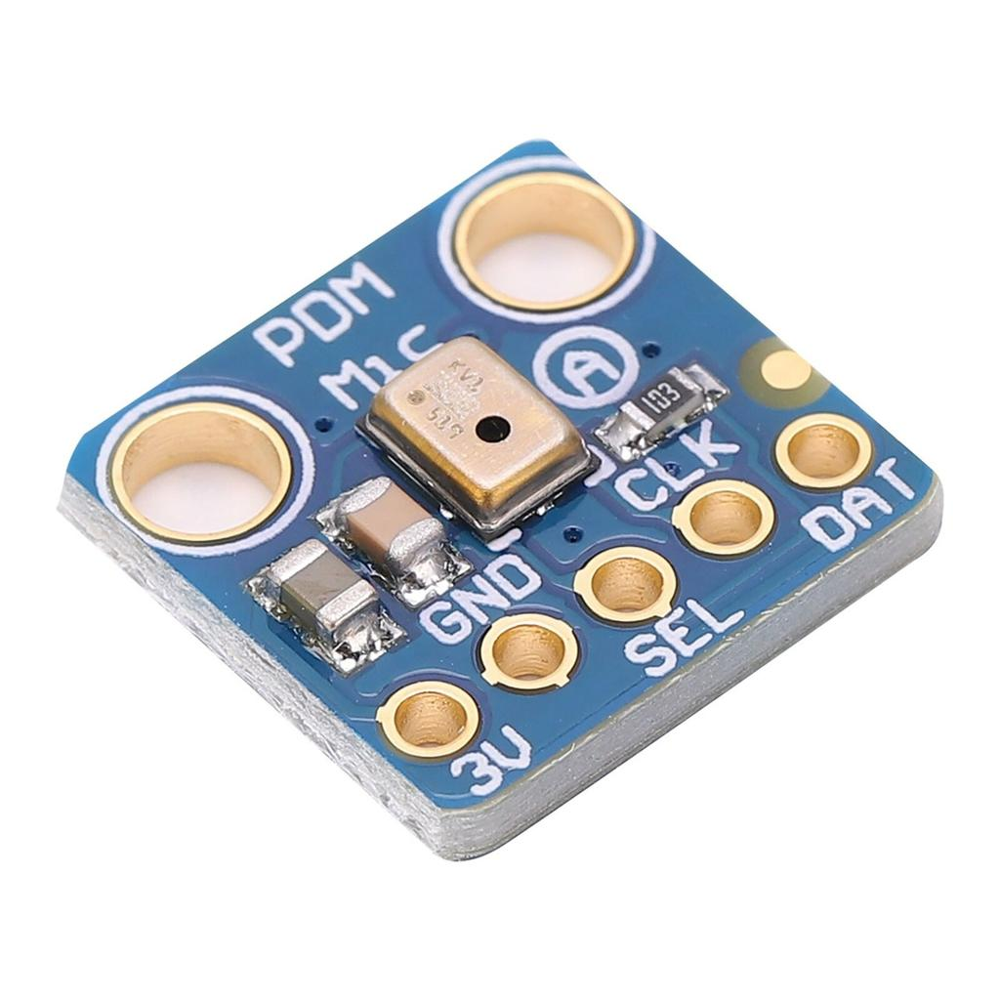
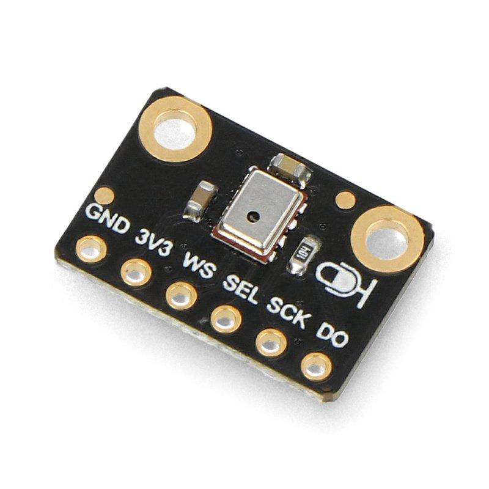
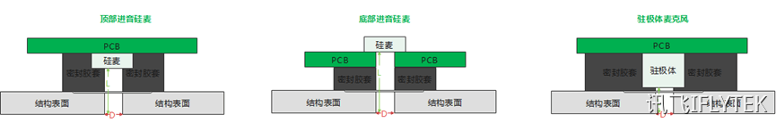
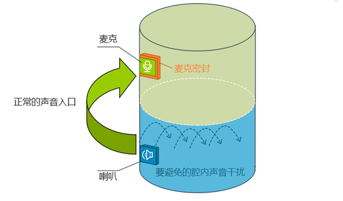

# 麦克风基础知识与结构设计

本文介绍常见的驻极体麦克风（ECM）和硅 MEMS 麦克风的基本结构、工作原理、接口区别与选型方法，并整理麦克风阵列的关键结构设计要求。

## 一、常见麦克风结构

### 1. 驻极体麦克风（ECM）

#### 内部结构

典型 ECM 主要由以下部分组成：

- **振膜：** 接收声波并产生机械振动。
- **背板：** 与振膜构成电容式换能结构。
- **驻极体材料：** 提供长期保持的电荷，可以位于振膜或背板侧，不能一律理解成带电背板。
- **FET 缓冲电路：** 将高阻抗信号转换为便于后级处理的电信号。

#### 工作原理

声波推动振膜振动，改变振膜与背板之间的电容。在驻极体提供的电场条件下，电容变化转化为电信号，再由内部 FET 缓冲电路输出模拟音频信号。

#### 主要特点

- 成本较低，技术成熟。
- 通常需要外部偏置电路。
- 一般输出模拟音频信号。
- 对模拟前端、电源噪声和 PCB 布线有一定要求。

**常见应用：** 通话设备、传统录音设备、低成本语音采集模块。

### 2. 硅 MEMS 麦克风（硅麦）

#### 内部结构

典型电容式硅 MEMS 麦克风主要包括：

- **微型振膜：** 感知声压变化。
- **固定背板：** 与振膜构成电容式换能结构。
- **声学腔体：** 为声压传递和振膜运动提供空间。
- **ASIC 芯片：** 负责信号放大，以及根据型号实现模数转换或数字处理。

#### 工作原理

声波通过声孔进入麦克风，推动微型振膜振动并引起电容变化。内部 ASIC 将其转换为可用的音频信号，输出形式取决于具体器件。

#### 常见接口

**模拟硅麦：** 输出模拟音频信号，需要通过外部 ADC 或音频 Codec 转换为数字数据。

**数字硅麦：** 常见输出为 PDM。PDM 是脉冲密度调制的 1 位数据流，主控需要提供时钟，并在后级完成抽取滤波后才能得到 PCM 音频。I²S 是串行数字音频接口，传输的是已经按声道和采样组织好的数字音频，两者不能互相替代。选型时应确认主控支持的接口类型、时钟要求和数据格式。

#### 主要特点

- 体积小，适合 SMT 贴片生产。
- 便于多麦克风阵列集成。
- 有模拟输出和数字输出型号。
- 仍需关注供电、声孔、PCB 布局和接口设计。

**常见应用：** 手机、无线耳机、智能音箱、会议终端和语音交互设备。

### 3. ECM 与硅 MEMS 的区别

| 对比项  | 驻极体麦克风（ECM） | 硅 MEMS 麦克风     |
| ---- | ----------- | -------------- |
| 换能方式 | 驻极体电容式      | 微机电传感结构，常见为电容式 |
| 常见封装 | 胶囊式         | 微型贴片式          |
| 输出类型 | 通常为模拟信号     | 模拟或数字信号        |
| 外围电路 | 通常需要偏置及模拟前端 | 取决于器件类型与接口     |
| 阵列集成 | 可以实现        | 通常更便于小型化集成     |
| 典型应用 | 通话、传统录音     | 智能终端、多麦克风阵列    |

### 4. 选型建议

- **选择 ECM：** 预算有限、需要模拟音频采集，且设备空间允许使用胶囊式麦克风。
- **选择硅 MEMS：** 需要小型化、贴片生产、多麦克风阵列，或希望使用数字音频接口。

硅 MEMS 并不必然比 ECM 音质更好，实际效果取决于器件指标、声学结构、外围电路和信号处理算法。

## 二、麦克风结构设计

麦克风的实际拾音效果不仅取决于传感器本身，还受到外壳开孔、声腔、密封、隔振及扬声器结构的影响。

### 1. 拾音孔与声学通道

#### 设计要求

- 麦克风声孔应与外壳拾音孔准确对齐。
- 密封硅胶应紧贴结构表面，避免漏声和不必要的空腔。
- 尽量缩短声音从外壳开孔到麦克风声孔的传播路径。
- 避免胶水、泡棉等材料遮挡拾音孔。

**开孔尺寸关系：**

结构开孔直径 ≥ 密封硅胶孔径 ≥ PCB 或麦克风声孔直径。

该关系可作为初步结构设计参考，实际尺寸还应结合器件封装和密封方式确定。

#### 拾音孔径深比

径深比定义为 δ = D / L。

其中：

- D：拾音孔直径。
- L：拾音孔深度。

参考设计建议：

- 径深比 δ ≥ 1/3。
- 推荐径深比 δ ≥ 1/2。
- 可优先评估直径约 1.3～1.5 mm 的开孔方案。

例如，孔径为 1.3 mm 时，若按径深比不小于 1/3 的经验值设计，孔深宜控制在约 3.9 mm 以内。

上述数值属于结构设计参考，不是适用于所有麦克风的统一标准。孔径、孔深和声腔共同影响声学阻抗及频率响应，应以器件资料和整机测试结果为准。

**设计目的：** 避免狭长声道和不合理声腔引起声学共振，减少频率响应异常。

### 2. 麦克风密封与隔振

设计时应重点关注：

- **密封：** 防止设备内部的声音通过缝隙直接进入麦克风。
- **隔振：** 减少外壳、PCB 或其他机械部件振动传递至麦克风。
- **声腔：** 避免不必要的封闭空间和狭长通道。
- **装配一致性：** 控制硅胶压缩量、开孔偏差和胶水溢出。

密封和隔振需要同时考虑，但两者作用不同：密封主要控制声泄漏，隔振主要控制机械振动传递。

### 3. 扬声器与麦克风的隔离

对于带扬声器的语音设备，应尽量降低扬声器声音经设备内部结构直接传递至麦克风的程度。

#### 设计建议

1. **合理布局：** 在结构允许的情况下增大扬声器与麦克风的距离。
2. **独立腔体：** 优先采用具有独立音腔的扬声器结构，并做好腔体密封与减振。
3. **隔音处理：** 对无法采用独立音腔的结构，可评估增加隔音材料或隔离结构。
4. **接口密封：** 对扬声器出音口与外壳的接合位置进行密封，避免声音泄漏至内部。
5. **材料选择：** 可评估发泡硅胶、聚氨酯泡棉等材料；材料硬度、厚度和压缩量应结合装配公差验证。

泡棉厚度应根据结构间隙、压缩率和密封要求确定，不宜直接套用固定倍数。材料选择也不应仅依据名称判断，应通过整机测试验证隔音、耐久性和装配可靠性。

#### 整机验证

- 扬声器最大工作音量下，检查麦克风输入是否发生削波或截幅。
- 检查播放声音对录音、唤醒和语音识别的影响。
- 验证密封结构是否存在漏声。
- 结合回声消除算法进行整机测试。

## 三、以语音交互设备为例

完整的语音采集系统通常包含三个层次：

1. **麦克风硬件：** 采集声音。
2. **音频前端：** 完成信号调理、采样和多通道同步。
3. **语音处理算法：** 实现波束形成、降噪、回声消除和语音识别。

对于远场会议拾音等应用，多麦克风阵列需要与声学结构和算法协同设计。具体产品采用的麦克风类型、数量和布局，应以对应型号的公开技术资料为准。

## 四、参考资料

- [科大讯飞开放平台：麦克风阵列设计参考](https://www.xfyun.cn/doc/solutions/hardwareUniversal/CAEdesign.html)
- [TDK InvenSense：MEMS 麦克风技术资料](https://invensense.tdk.com/)
- [Analog Devices：音频与数字 MEMS 麦克风技术资料](https://www.analog.com/en/resources.html)

## 五、总结

ECM 与硅 MEMS 的主要区别在于换能实现方式、封装形式及输出接口。硬件设计时，应优先确认器件规格和主控接口，再重点检查拾音孔、声腔、密封、隔振和扬声器隔离。

对于多麦克风语音设备，最终性能需要通过声学设计、音频链路和算法的协同验证来保证。
