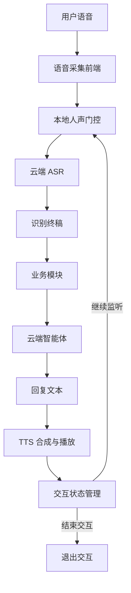
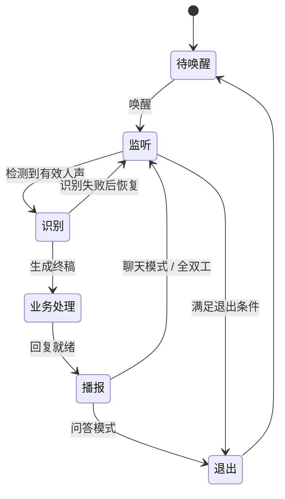
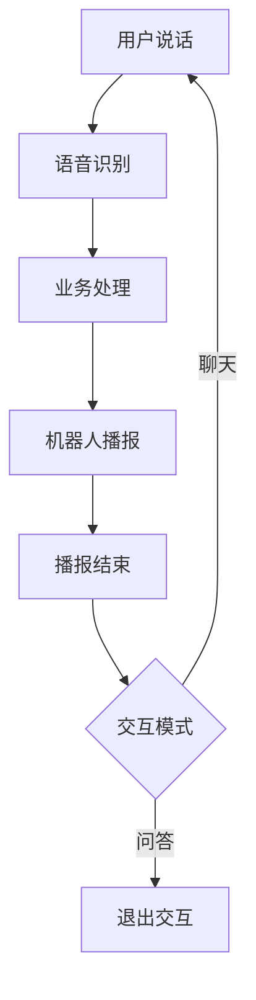
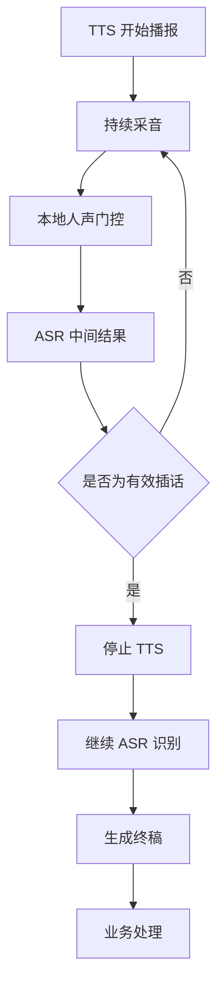
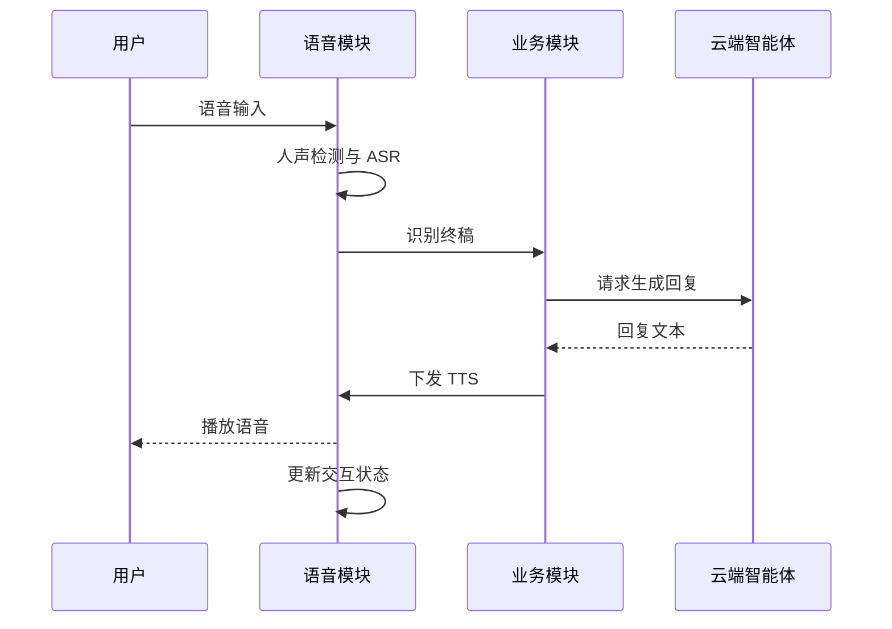

# 语音交互系统原理

## 1. 系统架构

语音交互系统负责语音采集、语音识别、对话处理、语音合成，以及整个交互过程的状态管理。

系统主要由四个部分组成：

- **语音前端**：采集音频、处理回声、检测唤醒词。
- **ASR**：将用户语音转换为文本。
- **业务模块与对话智能体**：处理用户请求并生成回复。
- **TTS**：将回复文本转换为语音并播放。

### 1.1 整体链路

唤醒检测与主链路并行运行。唤醒词或业务主动唤醒可以触发交互；ASR 负责语音转文本，业务模块负责对话处理，TTS 负责语音输出。

当前项目默认使用云端 ASR 和 TTS，语音模块本身不启动本地大语言模型。

## 2. 语音识别与合成

### 2.1 流式 ASR

流式 ASR 可以边接收音频边返回识别结果，无须等用户说完整句话才开始识别。

处理过程：

1. 本地人声门控检测到有效语音。
2. 系统将缓存的句首音频与后续实时音频发送给云端 ASR。
3. ASR 持续返回中间结果（Partial）。
4. 云端根据句末检测策略判断语句结束，生成终稿（Final）。
5. 终稿交给业务模块处理。

中间结果用于实时判断，终稿用于完成一轮语音输入。识别到部分文字不代表用户已经说完。

### 2.2 句末检测

句末检测决定何时将当前语音整理为完整的一句话。

等待时间过短，可能导致用户在句中短暂停顿时被提前截断；等待时间过长，则会增加交互延迟。

需要区分两个机制：

- **本地人声门控**：决定何时开始向云端发送音频。
- **云端句末检测**：决定何时结束当前语音识别。

两者分别控制音频输入和语句结束，不能混为一谈。

### 2.3 TTS 播放

TTS 将回复文本转换为音频并播放。播放开始、正常结束、失败和停止等事件都会影响交互状态。

半双工模式通常在播报期间停止采音；全双工模式则允许继续采音，并通过人声检测和插话判断区分用户语音与播报回声。

## 3. 交互状态机

语音系统需要统一管理唤醒、监听、识别、播报和退出，避免不同模块独立处理事件而产生冲突。

### 3.1 基本交互流程

该图表示主要逻辑，不代表所有模式都严格经过相同的状态序列。全双工模式下，监听和播报可以同时进行。

### 3.2 唤醒机制

系统支持两种唤醒方式：

- **被动唤醒**：采音前端检测到唤醒词后触发。
- **主动唤醒**：业务模块根据视觉检测等事件主动触发。

唤醒后，系统进入交互状态，根据场景直接开放麦克风，或先播放欢迎语再开始监听。

### 3.3 退出机制

当前项目主要通过以下条件退出交互：

- 用户说出有效的停止命令。
- 问答模式完成当前回复。
- 人员离开后达到规定的静音时间。
- 识别或播报长时间异常，触发超时保护。

问答模式通常完成一轮回复就退出；聊天和全双工模式可以在人员仍然在场时继续对话。

## 4. 半双工与全双工

### 4.1 半双工

半双工将用户输入和机器人播报分开处理。

播报期间停止采音，可以有效避免机器人自身声音进入 ASR。

优点是控制逻辑简单、回声处理压力较低；缺点是用户无法在普通播报过程中直接插话。

当前项目的问答和聊天模式均采用半双工策略，但问答模式在本轮回复后退出，聊天模式则继续监听。

### 4.2 全双工

全双工允许用户采音与机器人播报同时进行。

全双工的核心难点是区分真实用户语音与扬声器回声。系统不能仅凭 VAD 开门就停止播报，还需要结合识别文本进行确认。

## 5. 打断与插话机制

当前项目有三种主要的用户打断行为，以及一种业务侧停止操作。

| 触发方式 | 停止播报 | 识别会话 | 交互状态 |
|---|---|---|---|
| 唤醒词 | 立即停止 | 结束当前会话 | 保持交互，重新开始一轮 |
| 停止命令 | 立即停止 | 不再继续当前交互 | 退出交互 |
| 全双工有效插话 | 确认后停止 | 保留并继续识别 | 保持交互 |
| 业务主动停止 TTS | 停止 | 由业务流程决定 | 不一定退出 |

### 5.1 唤醒词打断

唤醒检测在交互过程中仍然有效。命中唤醒词后，系统停止当前识别会话，并中断正在播放的回复，随后播放唤醒应答。

应答结束后，系统重新开放麦克风。被打断的当前语句和回复不会自动恢复。

### 5.2 停止命令

停止命令用于结束当前交互，而不是开启新一轮对话。

当前项目要求命令词识别分数严格大于 1400 才执行停止操作，以降低误触发概率。命令通过后，系统退出交互并停止采音；如果 TTS 正在播放，则立即停止播报。

### 5.3 全双工插话判定

全双工模式采用多层判断降低误打断：

1. **起播保护**：TTS 开始后的 180 ms 内不开放人声门控。
2. **本地门控**：通过人声概率、持续时间和能量条件筛选音频。
3. **文本确认**：ASR 中间结果去除空白和标点后至少有两个有效字符。
4. **回声过滤**：如果中间文本与当前播报文本存在明显包含关系，或短文本匹配播报开头，则视为可能的回声。

确认有效插话后，系统停止 TTS，但保留当前 ASR 会话，继续识别用户的完整语句。

这些规则属于多层启发式保护，目的是降低误打断，并不能保证所有回声都被准确识别。

## 6. 对话生命周期管理

一轮对话包含输入、处理、输出和后续状态决策。

业务模块负责决定如何处理识别文本以及何时请求回复；语音模块负责识别、播放和交互状态控制。

这种职责划分使语音模块可以与不同的业务逻辑和对话智能体组合，而不需要把所有对话决策都放进语音处理链路。

播报结束后，系统根据当前模式决定继续监听还是退出。若发生打断，也需要明确区分停止播报、结束识别会话和退出交互，避免误取消用户尚未说完的内容。

## 7. 设计原则

语音交互系统的核心设计原则如下。

**1. 分层处理**

音频处理、语音识别、对话生成和交互控制各自承担明确职责，通过状态和事件协作。

**2. 区分检测与决策**

VAD 检测到人声，不代表用户已经说完；ASR 返回文字，也不代表文字一定来自用户。是否结束一句话、是否停止播报，应由对应的判断机制决定。

**3. 按交互模式控制采音**

半双工通过播报期间停采降低回声风险；全双工通过持续采音、多层门控和文本过滤实现插话。

**4. 明确打断语义**

停止 TTS、结束 ASR 和退出交互是不同操作。唤醒词、停止命令和普通插话应具有不同的状态处理逻辑。

**5. 平衡实时性与稳定性**

保护窗口和判定阈值需要在响应延迟、漏检概率、误打断和识别完整性之间权衡。

## 总结

语音交互系统不仅需要 ASR 和 TTS，还需要一套能够协调监听、播报、打断和退出的状态管理机制。

半双工通过分离采音与播报降低系统复杂度；全双工通过并行采音和有效插话判定提升交互自然度。理解识别链路、状态转换与打断语义，是分析和扩展语音交互系统的基础。