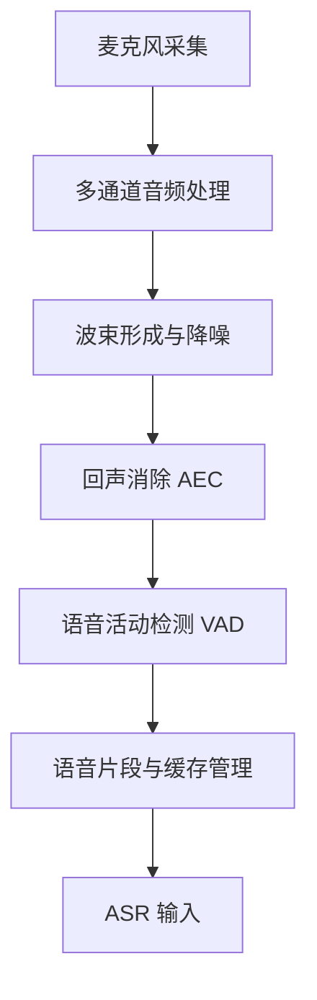
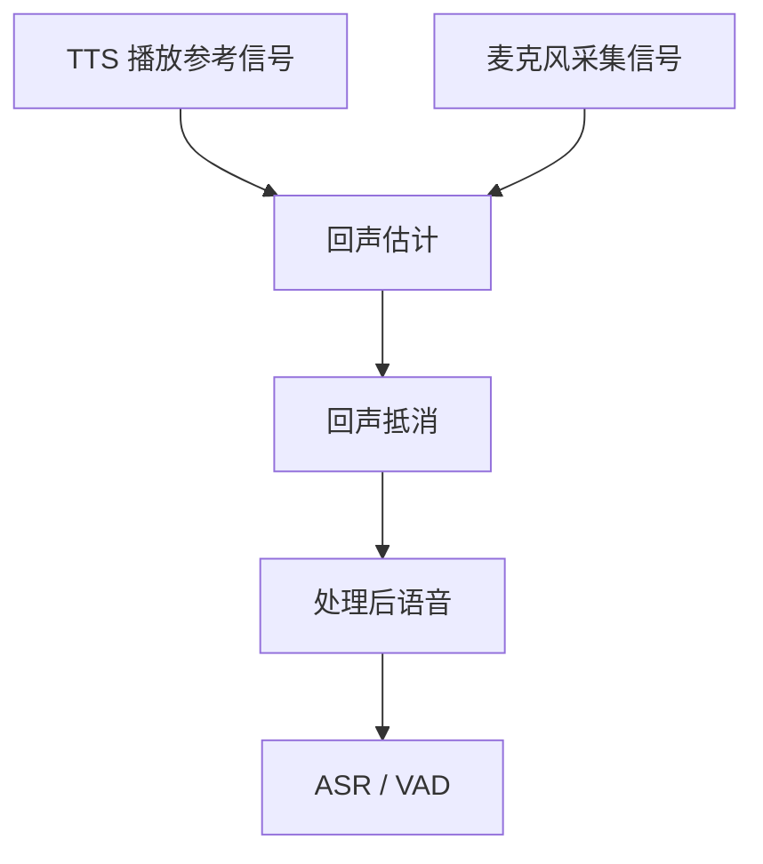
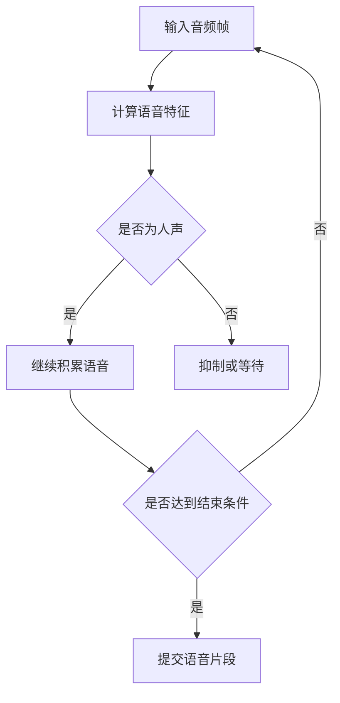
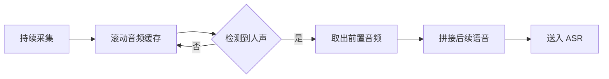

# 语音前端与鲁棒性处理原理

## 1. 语音前端处理链路

语音前端负责将麦克风采集的原始音频转换为适合语音识别的输入，并降低环境噪声、回声和非人声干扰。

实际系统不一定包含全部处理环节，具体取决于麦克风硬件、音频驱动和部署配置。各模块的执行顺序也可能因实现而异。

## 2. 音频采集与麦克风阵列

### 2.1 音频采集

采集模块持续读取麦克风音频数据，为后续处理提供输入。采集稳定性直接影响识别效果。

需要关注的关键因素：

- **采样率与通道数**：必须符合后续算法的输入要求。
- **缓冲区大小**：影响处理延迟和实时性。
- **音频增益**：过低会损失弱语音，过高可能造成削波。
- **设备稳定性**：丢帧、断流或设备切换可能导致识别异常。

### 2.2 单麦克风与麦克风阵列

| 类型 | 特点 | 主要限制 |
|---|---|---|
| 单麦克风 | 成本低、结构简单 | 难以利用空间信息区分声源 |
| 麦克风阵列 | 可利用多通道信号进行空间处理 | 依赖阵列布局、通道同步和标定 |

### 2.3 波束形成

波束形成利用多个麦克风接收到的信号差异，增强指定方向的声音并抑制其他方向的干扰。

波束形成不能保证完全隔离目标说话人。当噪声与目标语音方向接近，或声学环境复杂时，增强效果会受到限制。

## 3. 回声消除 AEC

当扬声器播放 TTS 时，声音可能再次被麦克风采集，形成回声。回声可能被 ASR 误识别，也可能被全双工逻辑误判为用户插话。

AEC（Acoustic Echo Cancellation，声学回声消除）利用扬声器播放参考信号，估计麦克风信号中的播放回声，并将其抵消。

AEC 的效果会受到以下因素影响：

- 扬声器与麦克风之间的声学耦合。
- 音量变化、设备移动和房间混响。
- 播放参考信号与实际输出之间的时延或不同步。
- 用户语音与扬声器声音同时存在时的信号差异。

**AEC 不等于静音。** 其目标是抑制扬声器回声，同时尽可能保留用户语音。AEC 效果不佳时，仍需要结合 VAD、ASR 文本过滤和交互状态判断，降低误触发概率。

## 4. 语音活动检测 VAD

VAD（Voice Activity Detection，语音活动检测）用于判断当前音频中是否存在有效人声，减少静音和非语音噪声进入后续识别流程。

VAD 主要解决“是否有人声”的问题，并不负责判断语义，也不直接决定用户是否完成一句话。

常见误判包括：

- **漏检**：轻声、远距离或被噪声覆盖的语音未被检测到。
- **误检**：音乐、机械声或突发噪声被判断为人声。
- **切分不合理**：停顿期间提前结束，或噪声导致语音片段持续过长。

VAD 参数通常需要在响应速度和识别完整性之间权衡。

## 5. Preroll 与语音片段管理

语音开始检测通常存在一定延迟。如果从 VAD 确认人声后才开始缓存，可能丢失语音开头。

Preroll（前置音频缓存）会持续保留最近一小段音频。当检测到人声后，将缓存中的前置音频与后续语音拼接，尽量保留完整的发音起始部分。

Preroll 过短，可能截断句首；过长，则可能带入更多噪声或前一段声音。因此需要根据采集延迟、VAD 响应速度和识别模型要求进行调整。

## 6. 半双工与全双工下的前端策略

前端处理需要与语音交互状态协同，不能只依赖音频信号本身。

| 场景 | 前端处理重点 |
|---|---|
| 待唤醒 | 持续采集并进行唤醒检测 |
| 用户说话 | 检测人声、缓存音频并送入 ASR |
| TTS 播报期间的半双工 | 通常不接受普通语音输入，降低回声误触发 |
| TTS 播报期间的全双工 | 持续采集，结合 AEC、VAD 和 ASR 判断是否为有效插话 |
| 播报结束 | 恢复相应监听策略，避免状态切换造成音频丢失 |

全双工场景尤其需要注意：检测到人声不代表用户正在插话。麦克风采集到的声音可能来自 TTS 回声、环境噪声或其他说话人，因此应结合回声抑制、识别文本和交互状态综合判断。

## 7. 鲁棒性问题与排查方向

| 现象 | 可能原因 | 优先检查方向 |
|---|---|---|
| 句首被截断 | VAD 检测延迟、Preroll 不足 | 前置缓存长度、VAD 启动条件 |
| 远距离语音识别差 | 信噪比低、增益不足、阵列方向不匹配 | 采集电平、麦克风布局、波束形成 |
| 播报内容被识别 | AEC 效果不足、播放与采集不同步 | 回声参考信号、AEC 时延、文本过滤 |
| 噪声触发识别 | VAD 阈值不合适、环境噪声较强 | VAD 判定条件、降噪和采集增益 |
| 语音尾部丢失 | 结束静音判定过早 | VAD 尾部保留时间、ASR 终止策略 |
| 全双工频繁误打断 | 回声或噪声被判断为有效插话 | AEC、有效文本长度、插话判定与状态管理 |
| 识别延迟偏高 | 缓冲区过大、处理链过长、结束条件过保守 | 采集分帧、前端耗时、VAD 与 ASR 时延 |

排查时建议先确认原始采集音频是否正常，再逐层检查前端处理输出，最后验证 ASR 和交互状态逻辑，避免把所有问题都归因于识别模型。

## 8. 设计原则

1. **先保证采集质量**：采集异常无法单靠后续算法完全补偿。
2. **区分检测与决策**：VAD 负责检测人声，交互模块负责判断是否接受输入或中断播报。
3. **保留必要上下文**：通过 Preroll 和合理的尾部保留，减少语音片段截断。
4. **前端与状态联动**：半双工和全双工应采用不同的输入策略。
5. **分层定位问题**：按采集、增强、AEC、VAD、缓存、ASR 的顺序检查。

语音前端的目标不是单独追求降噪强度，而是在尽量保留用户语音的同时，降低噪声、回声和切分错误对整条语音链路的影响。